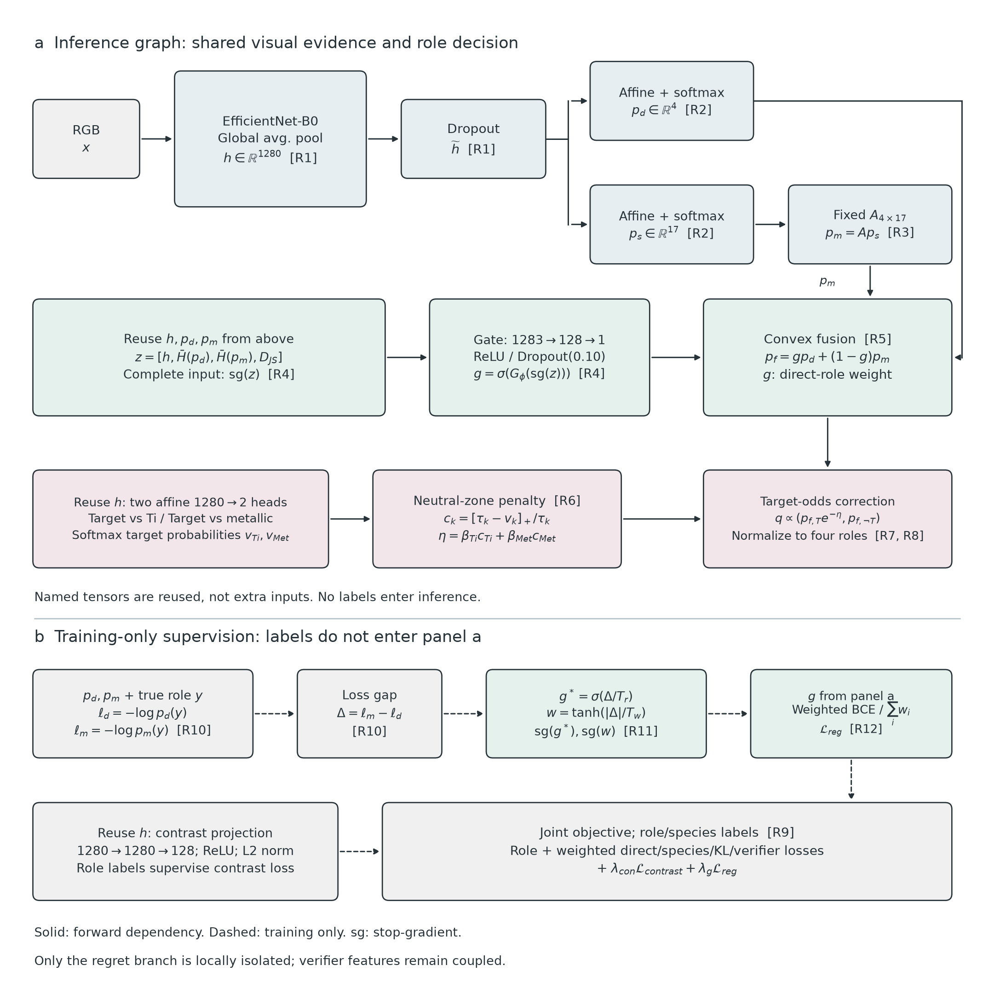
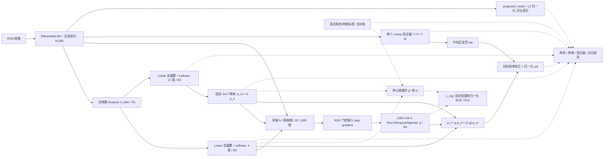

# 面向钒钛矿相关矿物视觉角色识别的跨粒度后悔监督门控验证网络

> 文稿状态（2026-11-07，一致性修订稿）：正文以已有 RSG-HRGV 结果为主线；[附录 A](theoretical_appendix.md)保存条件证明，[附录 B](development_diagnostics_appendix.md)保存后续开发与负结果，[附录 C](msb_role_methods_candidate.md)保存未验证的 MSB-RRE 候选。沿用2026-11-02整合稿及2026-11-03复现材料，核对已归档正式报告的证明边界。本轮只修订论文文字和证据映射，不改正式技术报告、模型代码或实验协议，不新增数据读取、训练或评价。路由后悔及自然对数损失用 nat，比例差用百分点；修订记录见[一致性整理](manuscript_consistency_2026-11-07.md)。

## 摘要（工作稿）

公开矿物标本图像具有拍摄条件异构、伴生矿物混杂和类内外观差异显著等特点，直接将其用于钒钛矿相关矿物识别时，目标矿物容易与含钛干扰矿物和金属光泽干扰矿物发生混淆。针对这一问题，本文构建包含 8,529 张图像的四类选矿角色数据集，在固定划分和重复图像分组约束下，提出跨粒度后悔监督门控验证网络（Regret-Supervised Hierarchical Risk-Gated Verification Network, RSG-HRGV-Net）。该网络以共享视觉主干为基础，通过直接角色专家和十七类矿物种类专家生成两条层级证据；门控以共享特征、熵和专家分歧为输入，并以真实类别下的专家损失差构造训练期软监督。双验证器和具有中性区的残差后验校正用于抑制两类困难负样本误入目标类。本文给出凸融合路由后悔精确分解、上界、软目标逼近和后悔分支局部梯度隔离等性质，并通过逐图局部上界对门控难度进行诊断。三随机种子正式对照显示，RSG-HRGV 的 Accuracy 为 76.45% ± 0.98%、Macro F1 为 74.76% ± 0.90%；总体分类指标的成对簇 Bootstrap 区间跨 0，但平均路由后悔相对 HRGV 降低 0.0177 nat，95% 区间为 [−0.0286, −0.0069] nat。在摄影者整体留出的独立三随机种子确认中，路由后悔相对该协议的匹配 HRGV 降低 0.0353 nat，95% 区间为 [−0.0475, −0.0217] nat；在严格匹配的 ResNet50 主干替换中，路由后悔降低 0.0333 nat，区间为 [−0.0486, −0.0198] nat。9 次高精度检查点重放覆盖 10,242 张图像，精确分解、B.1 和 B.2 的数值违反计数均为 0。上述结果支持跨粒度路由机制的受限有效性，而总体分类指标仍未呈现稳定增益。本研究验证了公开标本图像条件下的相关矿物视觉代理识别，不将结果解释为品位预测或工业分选回收率。

**关键词：** 钒钛磁铁矿；矿物图像识别；跨粒度证据；后悔监督；困难负样本；风险门控

## 1 引言

钒钛磁铁矿资源的综合利用涉及铁、钒和钛等组分的分阶段回收。陈超等[5]指出，钛磁铁矿是由磁铁矿主晶与钛铁晶石、钛铁矿等客晶构成的复合矿物，客晶粒度通常仅为 0.005--0.05 mm，且不同矿区的组分、嵌布与选别流程存在差异。矿物的颜色、光泽、形态和基质特征能够为预选和人工辅助识别提供视觉线索，但宏观 RGB 图像不能直接揭示元素含量、矿物嵌布状态或微观赋存关系。因此，视觉模型在本研究中被定位为相关矿物外观与选矿角色识别工具，而非 XRD、SEM-EDS、XRF 或化学分析的替代方法。

现有矿物图像研究已经覆盖闭集分类、关联矿物多标签识别和未知类别拒识等方向。Wu 等[1]以 Mindat 图片构建 36 类多标签任务，指出同一图像可包含多个矿物，并以 Transformer 多标签模型获得 85.26% 的 mAP。这说明页面主题矿物不能被简单等同为画面中唯一可见的矿物。Ji 等[2]在 36 类 Mindat 已知矿物和 15 类独立未知矿物上，将 ResNet 特征与 OCSVM 结合，以避免闭集分类器将未知矿物强行归入已知类别。Nesteruk 等[3]进一步构建原始矿物标本的零样本视觉基准，表明原始标本的细粒度识别与受控图片分类具有不同难度。Zhang 等[4]则面向真实场景的赤铁矿、磁铁矿、钛铁矿、褐铁矿、黄铁矿和岩石六分类，利用多个预训练网络及进化搜索完成多视角特征融合。宁金[6]在自建、受控机器视觉条件下，以特征工程和迁移学习完成钒钛矿检测，其最优联合模型报告了 99.3% 的准确率。该工作与本文均涉及钒钛矿视觉任务，但其受控图像、二分类目标和数据增强方式与公开标本图片上的四角色识别不同，不能直接比较准确率。上述研究说明多标签建模、拒识、原始标本基准和异构特征融合均已有明确路线，同时也表明，受控工业成像、公开标本图片和跨来源真实样本之间存在明显任务差异。对于公开标本图片，背景、基质和伴生矿物还可能形成非目标线索。

本项目的基线实验进一步显示，四类选矿角色的错误具有结构性。含钛干扰矿物和金属光泽干扰矿物较容易被误判为目标矿物，而简单采用类别加权或 Focal Loss 不能同时改善所有类别。这意味着性能瓶颈不只来自类别数量不平衡，还来自层级证据可靠性和特定困难负样本关系。基于这一观察，本文提出 RSG-HRGV-Net，将直接角色分类、矿物种类分类、样本级证据门控和困难负样本验证统一到同一网络中，并以真实类别下的专家相对损失差直接监督门控路由。

本文围绕“跨粒度证据如何路由，以及路由风险改善为何不必等于分类改善”组织贡献：

1. 在保留十七类矿物种类标签的四角色视觉代理任务上，构建 RSG-HRGV-Net。共享 CNN 同时产生直接角色证据和种类映射证据，训练期的专家损失差监督样本级门控，双验证器处理两类困难负样本的局部风险。网络贡献位于证据组织和监督关系，而非新的卷积算子。
2. 对该计算图给出路由后悔精确分解、门控偏离上界、软目标逼近及局部梯度隔离的条件分析，同时用总体目标非等价性和固定端点容量说明适用边界。这些性质用于解释可观测机制，不作为新的通用一致性、收敛或泛化理论。
3. 将结构分析与既有三随机种子对照、摄影者留出、第二 CNN 主干、组件消融和数值重放对应起来。证据支持预定义路由后悔下降及部分组件贡献，但总体分类增益未稳定建立；开发负结果和候选未验证状态同时保留。

## 2 相关工作与研究定位

### 2.1 公开矿物图片中的多标签与原始标本难题

公开矿物图片常同时展示主题矿物、伴生矿物、基质和人工背景。Wu 等[1]基于 Mindat 图片开展 36 类多标签矿物识别，并显示单张图片可能包含多种矿物。这提示页面标题不能被无条件视为画面唯一真值，单标签任务必须通过图像筛选、质量记录和结论边界处理弱标签噪声。Nesteruk 等[3]构建原始标本的零样本视觉基准，进一步说明原始标本中类间相似、类内差异和可见主体不完整会使识别任务显著不同于受控单矿物分类。

本文不将多标签识别或零样本识别作为新的算法主张。相反，当前数据保留页面矿物种类与四角色映射，并通过重复组隔离和视觉筛选构建可审计的闭集代理任务。伴生矿物和背景造成的残余标签不确定性被明确列为局限，而不是被静默当作无噪声单标签。

### 2.2 钒钛矿与铁矿视觉识别的已有路径

钒钛矿和铁矿的视觉研究已覆盖受控成像、迁移学习、未知类别处理和多模型融合。宁金[6]在自建机器视觉装置的受控数据上比较传统特征分类与 VGG19、InceptionV3、ResNet 迁移学习，针对钒钛矿检测报告了较高的二分类精度。Ji 等[2]将 ResNet 特征与 OCSVM 结合，专门处理已知矿物与未知矿物的区分。Zhang 等[4]在铁矿六分类中组合八个预训练网络并使用进化搜索优化多视角特征融合。这些研究分别解决了受控钒钛矿检测、开集矿物识别和异构主干融合问题。

它们不构成对本文结果的直接精度基准：宁金的自建受控二分类、Zhang 等的现场六分类和本文的公开标本四角色识别，在采集设备、样本实体、类别定义、来源结构和评价目标上均不同。特别是，陈超等[5]指出钛磁铁矿是含微细客晶的复合矿物，且流程选择与钛资源回收目标有关；因此，宏观 RGB 图像的角色分类不能被解释为矿相精确鉴定、元素含量或实际回收率。

### 2.3 本文的网络问题与贡献边界

已有多模型融合通常利用不同网络主干的表示互补，现有 OOD 方法则为未知类别设置独立的拒识机制。近期层级 MoE 已在程序粒度聚合和任务引导路由中使用多级专家 [7,8]，模型路由理论也已讨论未知源域混合下从独立模型池选择模型及其后悔界 [9]。因此，本文不把层级专家、上下文门控或路由后悔作为一般性首创。RSG-HRGV 的问题更具体：在同一共享主干中，直接角色专家和由 17 类矿物种类后验映射而来的角色专家处于同一四角色概率空间，但可能对单张图片给出分歧证据。本文不增加额外主干或把拒识写入核心结论，而是学习何时应更相信哪条语义粒度的既有证据。

具体地，RSG 使用真实角色下的专家损失差构造连续软门控目标，将门控误差转化为相对真值类概率更优专家的路由后悔。这里的后悔是当前样本的负对数似然差，不是未知源域混合下的策略价值或准确率后悔。两专家凸融合下，这一后悔具有精确分解和可验证上界；停止梯度进一步把专家学习和路由学习局部解耦。后续实验只检验这些预定义机制在固定测试、摄影者留出和第二卷积主干上的证据，不将其扩大为总体分类精度、工业分选、开集识别或一般化路由理论的普适优势。

专家与门控的联合学习至少可追溯到 Jacobs 等 [10] 的自适应局部专家混合模型，故本研究的网络主张必须落在具体的跨粒度证据、监督目标和失效诊断上。新增候选网络中的低秩交互、log 概率后处理及样本相关边界也已有先例，详见[附录 C 第 5.1 节](msb_role_methods_candidate.md)。本文不把这些标准构件改名后列为独立创新，亦不将候选设计的跨界能力视为已获得的分类增益。

## 3 数据与任务定义

### 3.1 数据来源与类别体系

数据集由公开矿物标本图片及其可追溯元数据构成，共包含 8,529 张图像。依据矿物在本研究视觉代理任务中的作用，图像被组织为目标矿物、含钛干扰矿物、脉石/废石和金属光泽干扰矿物四类。其中，目标矿物包含钛铁矿、钛磁铁矿和普通磁铁矿代理样本；含钛干扰矿物包括金红石、锐钛矿、榍石和钙钛矿等；脉石/废石和金属光泽干扰类由相应矿物种类组成。普通磁铁矿仅作为外观代理来源，不能等同为钛磁铁矿真实样本。

每张图片保留矿物名称、来源页面、Mindat 图片编号、原始文件名、筛选决策和本地路径等字段。图像筛选排除主体不清、混合矿物过多、严重模糊或曝光异常、人物或标尺遮挡过大以及不适合宏观图像识别的显微图片。

### 3.2 去重与数据划分

数据治理同时使用 SHA-256、Mindat 图片编号和感知哈希识别完全重复与近重复图片，并将同一重复组约束在单一数据划分中。最终训练集、验证集和测试集分别包含 5,961、1,284 和 1,284 张图像。训练阶段的数据增强只作用于训练集，验证集和测试集保持固定，以避免同源增强图像跨集合造成信息泄漏。

### 3.3 评价指标

总体指标采用 Accuracy 和 Macro F1。考虑选矿角色识别中的非对称风险，另报告目标类召回率、目标类漏选率、含钛干扰误入目标类比例和金属光泽干扰误入目标类比例。所有主要模型使用三个固定随机种子重复训练，并报告均值和样本标准差。固定测试集上的差异使用成对簇 Bootstrap 估计区间，抽样单元与数据分组保持一致。

## 4 RSG-HRGV-Net

### 4.1 层级双专家

设输入图像为 $x$，共享 EfficientNet-B0 主干为 $f_\theta$，其输出特征为

$$
h=f_\theta(x)\in\mathbb{R}^{1280},\qquad \widetilde h=\operatorname{Dropout}(h).
\tag{R1}
$$

其中 $h$ 表示卷积特征经全局平均池化后的向量，$\widetilde h$ 是供两个分类头使用的训练期 Dropout 特征；推理时 Dropout 为恒等映射。直接角色专家和矿物种类专家分别输出四类角色后验和十七类矿物种类后验：

$$
p_d(\cdot\mid x)=\operatorname{softmax}(W_d\widetilde h+b_d),\qquad
p_s(\cdot\mid x)=\operatorname{softmax}(W_s\widetilde h+b_s).
\tag{R2}
$$

令 $A\in\{0,1\}^{4\times17}$ 为固定的矿物种类—选矿角色映射矩阵，且每一列只有一个元素为 1。种类专家可诱导出角色后验

$$
p_m(\cdot\mid x)=A p_s(\cdot\mid x).
\tag{R3}
$$

直接角色专家利用粗粒度角色监督，种类专家利用细粒度矿物监督。两者对同一图像的预测分歧还可以作为证据可靠性的显式信号。

### 4.2 可靠性门控

对四类概率向量定义 $\bar H(p)=-\sum_jp_j\log p_j/\log4$；令 $\bar p=(p_d+p_m)/2$，则 $D_{\mathrm{JS}}(p_d\Vert p_m)=\{D_{\mathrm{KL}}(p_d\Vert\bar p)+D_{\mathrm{KL}}(p_m\Vert\bar p)\}/2$。可靠性门控以池化特征、两路归一化熵和该分歧为输入，RSG 主配置对完整拼接输入使用停止梯度算子 $\operatorname{sg}$：

$$
z=\left[h,\bar H(p_d),\bar H(p_m),D_{\mathrm{JS}}(p_d\Vert p_m)\right],\qquad
g(x)=\sigma\!\left(G_\phi(\operatorname{sg}(z))\right).
\tag{R4}
$$

融合角色后验为

$$
p_f(y\mid x)=g(x)p_d(y\mid x)+[1-g(x)]p_m(y\mid x).
\tag{R5}
$$

这里 $g$ 是直接角色专家的连续权重，不是对正确性的保证；推理只依赖图像及其网络输出，不读取真实标签。停止梯度不改变前向数值，其训练影响在第 5.8 节给出。

### 4.3 双困难负样本验证与残差校正

网络设置两个二分类验证器：$v_{Ti}(x)$ 用于区分目标矿物与含钛干扰矿物，$v_{Met}(x)$ 用于区分目标矿物与金属光泽干扰矿物。验证器只在对应的目标—困难负样本子集上计算损失，使其学习针对性的局部决策边界。

为避免旧式乘法校正在验证器给出支持证据时仍持续改变目标后验，本文定义带中性区的残差惩罚：

$$
c_h(v_h)=\frac{[\tau_h-v_h]_+}{\tau_h},\qquad
\eta(x)=\beta_{Ti}c_{Ti}(v_{Ti})+\beta_{Met}c_{Met}(v_{Met}),\qquad
\tau_h\in(0,1],\ \beta_h\ge0.
\tag{R6}
$$

若 $T$ 表示目标角色，则最终后验为

$$
q_T=\frac{p_{f,T}e^{-\eta}}{p_{f,T}e^{-\eta}+\sum_{j\ne T}p_{f,j}},
\tag{R7}
$$

$$
q_j=\frac{p_{f,j}}{p_{f,T}e^{-\eta}+\sum_{\ell\ne T}p_{f,\ell}},\qquad j\ne T.
\tag{R8}
$$

当两个验证器均达到中性阈值时，$\eta=0$ 且 $q=p_f$；只有验证器给出反对证据时，目标后验才被抑制。

### 4.4 训练目标

完整损失为

$$
\mathcal L=\mathcal L_{role}
+\lambda_d\mathcal L_{direct}
+\lambda_s\mathcal L_{species}
+\lambda_c\mathcal L_{KL}
+\lambda_v(\mathcal L_{Ti}+\mathcal L_{Met})
+\lambda_{con}\mathcal L_{contrast}
+\lambda_g\mathcal L_{reg}.
\tag{R9}
$$

$\mathcal L_{role}$ 监督最终后验，$\mathcal L_{direct}$ 和 $\mathcal L_{species}$ 分别监督两个专家，$\mathcal L_{KL}=D_{KL}(p_m\Vert p_d)$ 约束两条层级证据，$\mathcal L_{Ti}$ 和 $\mathcal L_{Met}$ 训练验证器，$\mathcal L_{contrast}$ 在表示空间中强化目标类与两类困难负样本的关系约束，$\mathcal L_{reg}$ 监督门控降低样本级专家选择后悔。

### 4.5 后悔监督门控

仅依靠熵和专家分歧训练门控时，融合损失并不直接说明当前样本应选择哪一位专家。为此，对真实角色 $y$ 定义

$$
\ell_d=-\log p_d(y\mid x),\qquad
\ell_m=-\log p_m(y\mid x),\qquad
\Delta=\ell_m-\ell_d.
\tag{R10}
$$

软门控目标和差距权重分别为

$$
g^*=\sigma(\Delta/T_r),\qquad
w=\tanh(|\Delta|/T_w),\qquad T_r,T_w>0.
\tag{R11}
$$

单样本项为 $w_i\operatorname{BCE}(g_i,g_i^*)$。实际训练按批次 $\mathcal B$ 的权重和归一化；令 $W_{\mathcal B}=\sum_{i\in\mathcal B}\operatorname{sg}(w_i)$，$\widetilde g_i=\operatorname{clip}(g_i,\varepsilon_{\mathrm{num}},1-\varepsilon_{\mathrm{num}})$，则

$$
\mathcal L_{reg}^{\mathcal B}=
\begin{cases}
\dfrac{\sum_{i\in\mathcal B}\operatorname{sg}(w_i)
\operatorname{BCE}(\widetilde g_i,\operatorname{sg}(g_i^*))}{W_{\mathcal B}},
& W_{\mathcal B}>\varepsilon_{\mathrm{num}},\\
0,&W_{\mathcal B}\le\varepsilon_{\mathrm{num}}.
\end{cases}
\tag{R12}
$$

这里 $\varepsilon_{\mathrm{num}}$ 为实现所用数据类型的数值下界。后文实数概率的性质分析须与有限精度截断区分，不能将批次归一化损失的期望直接替换为总体权重比值。式 R9 中的 $\mathcal L_{reg}$ 按式 R12 实现。

当直接角色专家在真实类别上的损失更小时，$g^*$ 趋近 1；当种类映射专家更可靠时，$g^*$ 趋近 0。权重 $w$ 降低两位专家近似等价样本的监督强度。RSG 配置同时停止门控完整输入、软目标和权重的梯度，故后悔损失分支只更新门控参数；仅停止软目标和权重的梯度不足以阻断经门控输入返回主干的路径。其他任务损失仍训练共享表示。该隔离范围与第 5.8 节及源码 `detach_gate_features` 一致。

### 4.6 结构与公式的对应关系

下图将 RSG 主配置排版为推理与训练两个面板，并对应 R1–R12。实线表示前向依赖，虚线表示仅训练时的监督关系；重复出现的同名张量来自相同上游输出，不是额外输入。专家头使用 Dropout 后特征，门控、验证器和对比投影使用池化特征。主干内部沿用 EfficientNet-B0，不插入 MSB 或其他候选模块。

图1. a，双专家、门控融合与双验证器的推理路径；b，仅训练使用的真值类专家差距、软目标、差距加权和联合损失。RSG完整门控输入、软目标及权重停止梯度，但验证器仍与主干耦合。图中的R12为缩写，零权重分支及截断约定以正文公式为准。矢量版：[PDF](materials_2026-11-03/fig_rsg_r1_r12.pdf)、[SVG](materials_2026-11-03/fig_rsg_r1_r12.svg)；[完整图注及排版源](materials_2026-11-03/figure_readme.md)。以下保留原Mermaid拓扑源以便核对，不是第二套网络。

| 模块 | 维度或计算 | 公式 / 源码位置 | 理论及证据边界 |
|---|---|---|---|
| 共享视觉主干 | 池化 $h\in\mathbb R^{1280}$；两个分类头使用 $\widetilde h$ | R1；`build_visual_backbone`、`forward` | 继承既有 CNN，不称新卷积结构 |
| 跨粒度双专家 | Linear $1280\to4$、$1280\to17$；固定映射 $4\times17$ | R2--R3；`role_head`、`species_head` | 同一图像的两种语义粒度，不是独立传感器 |
| 样本级门控 | $1283\to128\to1$；ReLU、Dropout(0.10)、Sigmoid | R4--R5；`gate_network`、`mix_role_experts` | $d_g=128$ 已由所选18份环境记录核对；不是仅凭默认值 |
| 双验证器 | 两个 Linear $1280\to2$，各取目标概率 | R6--R8；`apply_residual_target_verifiers` | 目标赔率单向抑制，不保证无召回代价 |
| 对比表示 | $1280\to1280\to128$，ReLU 后投影并作 L2 归一化 | R9；`projection_head` | $d_e=128$ 已由所选18份环境记录核对；训练期辅助，不是新增传感证据 |
| 后悔监督 | 真值损失差、停止梯度软目标、批次权重归一化 | R10--R12；`regret_gate_targets`、`weighted_soft_gate_loss` | 真值仅训练可用；局部隔离不冻结整个主干 |

完整计算图为“图像 → 双专家 → 连续门控融合 → 残差验证 → 四角色后验”。训练另外读取角色与种类标签；推理不计算真值专家选择或后悔监督目标。主配置的验证器与共享表示耦合，停止验证器特征梯度是消融配置，不能与 RSG 对门控输入的局部隔离混为一谈。

公式按实数概率写出主要关系；数值实现对熵和JS的输入概率先作下界截断再归一化，对取对数及BCE另作安全截断。第5章证明应在其列出的概率条件下解释，第7.8节的既有重放另行报告有限精度容差。源码结构默认值不是所有运行超参数的替代记录。

RSG 的可主张改进是将跨粒度证据选择转化为显式训练目标，并为其设置可诊断的路由风险。它不扩大基础 CNN 的卷积算子集合，也尚未建立稳定的总体分类优势。另一路 MSB-RRE 采用冻结表示的后端修正，仅在附录 C 保留，不与本节训练图合并。

### 4.7 网络改进的单位与验证范围

本文的方法贡献是特定任务上的证据组织与训练策略，不能把使用多个分类头本身视为新网络理论。相对单头 EfficientNet-B0，HRGV 增加了种类映射专家、门控及局部验证路径；相对匹配 HRGV，RSG 沿用推理拓扑，改变训练期的后悔监督和完整门控输入梯度路径。停止梯度不改变前向数值，RSG 因而不是一种新的卷积主干，也不能仅凭训练开关宣称推理函数族得到扩展。

| 改进单位 | 结构或公式位置 | 已有检验 | 能支持的主张 |
|---|---|---|---|
| 跨粒度证据组织 | 直接四角色专家与十七种类映射专家，R1–R5 | 专家互补性及固定专家诊断，第7.5、7.9节 | 存在有限的分歧与可路由样本；未证明学习门控独立优于等权融合 |
| RSG训练策略 | 损失差软目标、差距权重及完整门控输入隔离，R10–R12、R4 | 三协议匹配对照及门控消融，第7.5–7.8节 | 完整策略的已定义路由后悔下降；不能仅归因于增加一个损失项 |
| 困难负样本关系约束 | 对比表示及R9的辅助损失 | HRGV移除对比约束消融，第7.2节 | 当前HRGV配置下有分类组件证据；不是新主干或普遍优势证明 |
| 局部验证与残差校正 | 双验证器及中性区目标赔率抑制，R6–R8 | 验证器消融，第7.3节 | 改变误入与漏识的取舍，非无代价增强 |

精确分解、上界、熵正则化解释和局部隔离用于说明上述计算图的可检验性质，不按公式数量计为多个独立首创。网络效果、数学正确性和相对已有文献的新颖性分别需要相应依据；当前证据不能相互替代。第一篇论文据此以跨粒度路由机制及其边界为主线，不以尚未验证的表达能力增强为结论。

## 5 理论性质

本节按用途区分理论层次：第 5.1、5.3、5.4、5.5 节是经典性质及条件化应用，不作为四项独立原创贡献；第 5.2、5.6 至 5.8 节解释当前网络的输出和监督机制；第 5.9 节分析这些机制为何不必产生分类改进。候选 MSB 的新增推导另列，避免以命题数量代替创新性或实验证据。

### 5.1 凸融合对数损失上界

对任意真实角色 $y$ 和 $g\in[0,1]$，由 $-\log t$ 的凸性可得

$$
-\log p_{f,y}\leq g[-\log p_{d,y}]+(1-g)[-\log p_{m,y}].
$$

该式说明概率空间融合的样本对数损失不超过两个专家损失的对应凸上界，但不保证学习门控必然优于等权融合。

### 5.2 残差校正的恒等性和单调性

若所有验证器均满足 $v_h\geq\tau_h$，则 $q=p_f$。对任意非目标角色 $j$，有

$$
\frac{q_T}{q_j}=\frac{p_{f,T}}{p_{f,j}}e^{-\eta},\qquad
\frac{\partial}{\partial c_h}\log\frac{q_T}{q_j}=-\beta_h\leq0.
$$

任意两个非目标角色 $j,k$ 仍满足 $q_j/q_k=p_{f,j}/p_{f,k}$。因此，残差校正只在反对证据出现时单调降低目标角色相对赔率，并保持非目标角色之间的相对顺序。

### 5.3 严格验证式接纳的误收上界

设 $E_0$ 为基础分类器将某类困难负样本判为目标的事件，$E_h$ 为对应验证器错误放行的事件。若部署时只有两者同时成立才接纳为目标，则

$$
P(E_0\cap E_h)\leq\min\{P(E_0),P(E_h)\}.
$$

条件独立时，上式进一步化为二者概率的乘积。该结论适用于严格验证式接纳规则，不应扩大解释为软后验校正必然降低所有误收。

### 5.4 带拒识的贝叶斯最优决策

给定动作集合 $\mathcal A$、错误代价 $C(y,a)$ 和拒识代价 $c_{rej}$，直接动作的最小条件风险为

$$
R_{act}(x)=\min_{a\in\mathcal A}\sum_y C(y,a)q(y\mid x).
$$

逐点比较直接动作风险和拒识代价，可得到

$$
\delta^*(x)=
\begin{cases}
\operatorname*{arg\,min}_{a\in\mathcal A}\sum_y C(y,a)q(y\mid x), & R_{act}(x)\leq c_{rej},\\
\mathrm{reject}, & R_{act}(x)>c_{rej}.
\end{cases}
$$

当 $q(y\mid x)$ 等于真实条件后验、代价已知且拒识后总损失确为常数 $c_{rej}$ 时，该规则为贝叶斯最优选择性决策。使用网络估计后验时，它只最小化该估计后验定义的条件风险，不能仅凭概率校准宣称真实风险最优。若拒识意味着送检，拒识风险还应包括检测后的残余决策损失，而不一定只有检测费用。现有数据没有真实化验成本，本文只验证风险—覆盖率关系，不将其解释为工业送检成本最优。

### 5.5 验证器梯度隔离

若验证器输入使用 $\operatorname{stopgrad}(h)$，则链式法则给出

$$
\frac{\partial\mathcal L_v}{\partial\theta}=0,
$$

而验证器自身参数仍可更新。该性质用于构造耦合与隔离消融，不表示梯度隔离一定提高识别性能。

### 5.6 门控误差与路由后悔上界

令 $a=p_d(y\mid x)$、$b=p_m(y\mid x)$，$M=\max(a,b)$、$d=|a-b|$、$\delta=|g-g_o|$，且 $a,b\geq\varepsilon>0$。若 $g_o=\mathbb I(a\geq b)$ 是硬最优门控，$p_g=ga+(1-g)b$，则首先有精确分解

$$
p_g=M-\delta d,\qquad
-\log p_g+\log M=-\log\left(1-\frac{\delta d}{M}\right).
$$

因此，在固定 $M$、保持另一变量不变且 $\delta d<M$ 时，路由后悔对 $\delta$ 和 $d$ 分别非减；另一因子为正时才严格增加。跨样本或跨模型比较中 $M$ 可能变化，不能只凭绝对专家差距增大作出同样推断。进一步有

$$
0\leq-\log p_g+\log\max(a,b)
\leq\frac{|g-g_o||a-b|}{\varepsilon}.
$$

上界由 $-\log t$ 在 $[\varepsilon,1]$ 上的 Lipschitz 性质得到。精确分解与上界为强调专家分歧样本提供设计动机，但 $w=\tanh(|\log(a/b)|/T_w)$ 并非该界的唯一推导结果，不能称其权重形式已被定理证明最优。第 7.6 节的无权重消融也未建立稳定增益。上述性质只约束预定义路由指标，不保证总体分类指标必然提高。

图 6 给出该精确关系的解析曲线：令 $u=\delta d/M$，则 $r=-\log(1-u)$。左图同时给出一阶参考 $r=u$，表明小门控偏离或小专家差距时后悔近似线性；右图在固定 $d/M$ 下展示，专家差距越大，同等门控偏离造成的后悔增长越快。该图是由定理直接生成的理论可视化，不是从分类准确率、Macro F1 或训练曲线拟合得到。

### 5.7 软目标对硬最优门控的逼近

对 $\Delta\neq0$，令 $g_o=\mathbb I(\Delta\geq0)$，则

$$
|g^*-g_o|\leq\exp(-|\Delta|/T_r).
$$

因此，软目标在专家差距较大时指数逼近硬选择，在专家接近时保留不确定性。本文通过软目标、硬目标与无差距加权三组受控消融检验这一设计。

软目标也可由熵正则化的训练期专家选择问题导出。令

$$
J_{T_r}(t)=t\ell_d+(1-t)\ell_m+T_r[t\log t+(1-t)\log(1-t)].
$$

对 $T_r>0$，其二阶导数为 $T_r/[t(1-t)]>0$，令一阶导数为零即得唯一最优解 $t^*=\sigma((\ell_m-\ell_d)/T_r)=g^*$。这给出温度参数的熵正则化解释，属于经典正则化选择原理的两专家实例化，不能作为独立首创。需要注意，$J_{T_r}(g)-J_{T_r}(g^*)=T_r D_{KL}(\mathrm{Ber}(g)\Vert\mathrm{Ber}(g^*))$，而实际 BCE 的超额损失是反方向的 $D_{KL}(\mathrm{Ber}(g^*)\Vert\mathrm{Ber}(g))$；两者最优点相同，但并非相同训练目标。完整推导及来源见理论附录 A.4a。

### 5.8 后悔监督的局部梯度隔离

令门控输入与R4一致，为 $z=[h,\bar H(p_d),\bar H(p_m),\operatorname{JS}(p_d,p_m)]$。在当前实现中，同时对软目标 $g^*$、权重 $w$ 以及门控的完整输入 $z$ 停止梯度，即 $g=\sigma(G_\phi(\operatorname{stopgrad}(z)))$，且门控参数 $\phi$ 不与专家共享，可由链式法则得到 $\nabla_{\theta,\psi_d,\psi_s}\mathcal L_{reg}=0$。门控参数的梯度仍可非零，但输出端非零导数并不保证参数梯度每步非零；截断平坦区、门控雅可比和批次抵消均需区分。R12的批次分母采用停止梯度的权重，不改变该局部隔离结论。仅停止目标和权重的梯度并不足以保证隔离，因为损失仍可经门控输入反传到专家和主干。实现中的 `detach_gate_features=True` 切断这一输入路径；该性质只隔离 $\mathcal L_{reg}$ 分支，不切断角色、种类、验证器和对比损失对共享表示的训练。

### 5.9 从路由风险到分类纠错的能力边界

门控监督、概率风险和分类错误是三个不同对象。理论附录 A.4b 已给出反例：即使专家固定、数据无限且优化充分，标签相关加权软目标 BCE 的条件最优门控也不必最小化融合 NLL。由此不能把“后悔下降”替换成“概率风险最优”，更不能进一步替换成“召回必然提高”。

另设固定四类后验 $q_{0,i},q_{1,i}$ 的最大类别均唯一，逐图标量融合为 $q_{\rho,i}=(1-\rho_i)q_{0,i}+\rho_iq_{1,i}$，$\rho_i\in[0,1]$。令 $D_i=\mathbf1[\arg\max q_{0,i}\ne\arg\max q_{1,i}]$，则

$$
|\operatorname{Acc}(q_\rho)-\operatorname{Acc}(q_0)|\leq N^{-1}\sum_iD_i.
$$

证明只需观察：两端同属类别 $k$ 时，对每个 $j\ne k$，两端的正间隔经凸组合后仍严格为正，因而分类不变；准确率变化只能来自两端类别不同的样本。目标召回的增加同样只能来自回退原本漏识且两端类别不同的真实目标。该结论是固定端点、有限样本的容量界，不是新网络的泛化界。ABMP 已归档开发记录中，两端只有 14/1696 个分类分歧，回退漏识目标中的分歧为零，因此在那一对固定端点之间继续调路由不能提高目标召回。

上述容量限制仅解释既有固定端点路线的负结果，不决定全部非线性模型的能力。[附录 C](msb_role_methods_candidate.md)保留角色成对间隔修正的未验证候选及其跨界条件；允许跨界也允许破坏正确预测，不能由此推出净纠错。第一篇论文不以该候选为主方法，也不追加其实验来支撑当前结论。

## 6 实验设计

### 6.1 对比与消融

基础对比包括 ResNet50、EfficientNet-B0、加权交叉熵、Focal Loss、角色感知多任务网络和分层 EfficientNet-B0。HRGV 消融包括等权融合、移除角色感知对比约束、验证器梯度隔离、移除验证器以及旧乘法校正。固定划分与第二主干正式对照使用随机种子 20260727、20260728 和 20260729；摄影者留出正式对照使用 20260727、20260729 和 20260730，其筛选种子 20260728 不纳入正式估计，详见第6.3、7.7节。

### 6.2 统计分析

每个配置报告三个随机种子的均值和样本标准差。对使用相同固定测试集的模型，以图像分组为簇进行成对 Bootstrap，估计 Accuracy、Macro F1、目标召回和两类误入目标比例差异的 95% 区间。区间跨 0 的比较不表述为显著优势。

### 6.3 实现与复现信息

对固定划分、摄影者留出和ResNet50确认的18份正式环境记录进行非实验核对，门控隐藏层与对比嵌入均为128维。RSG采用 $\lambda_d=0.25,\lambda_s=0.50,\lambda_c=0.10,\lambda_v=0.50,\lambda_{con}=0.10,\lambda_g=0.10$，$T_r=0.20,T_w=0.50$，对比温度为0.10；两验证阈值均为0.50，惩罚强度均为1。主配置保留验证器特征耦合。HRGV参考同时关闭后悔损失和门控输入隔离，因此主对比评价的是完整RSG训练策略，不把效果单独归因于其中一个开关。

固定划分及第二主干的正式种子为20260727/28/29；摄影者留出使用20260727/29/30，筛选种子20260728不计入其正式估计。18份环境记录均标为CUDA设备、PyTorch 2.12.1+cu130，但未逐次保存批量大小、优化器参数、GPU型号和完整依赖锁定。本文不以源码默认值或后期硬件信息回填。完整参数、逐次原件哈希、硬件缺口及复现层次见[复现材料表](reproducibility_materials.md)。本次材料整理未读取权重或预测文件、未重算结果。

## 7 结果

### 7.1 HRGV 主要结果

| 设置 | Accuracy | Macro F1 | 目标召回 | 含钛误入目标 | 金属光泽误入目标 |
|---|---:|---:|---:|---:|---:|
| 耦合残差 HRGV | 76.48% ± 0.23% | 74.59% ± 0.34% | 72.38% ± 3.22% | 9.16% ± 1.13% | 11.55% ± 1.18% |
| 等权融合 | 75.91% ± 0.29% | 74.01% ± 0.33% | 73.04% ± 2.99% | 9.78% ± 1.47% | 12.31% ± 2.37% |
| 无角色感知对比约束 | 75.39% ± 0.86% | 73.51% ± 0.56% | 71.05% ± 2.65% | 9.78% ± 2.74% | 10.98% ± 2.15% |
| 梯度隔离残差 HRGV | 74.71% ± 1.56% | 72.99% ± 2.15% | 75.03% ± 4.30% | 10.05% ± 0.62% | 13.64% ± 2.05% |
| 仅门控、无验证器 | 76.74% ± 0.65% | 74.91% ± 0.41% | 74.37% ± 0.83% | 9.78% ± 1.47% | 11.74% ± 0.87% |
| 旧乘法验证 | 75.91% ± 0.83% | 74.25% ± 1.02% | 71.05% ± 1.80% | 9.91% ± 1.05% | 12.12% ± 0.87% |

耦合残差 HRGV 在三次训练中获得 76.48% 的平均 Accuracy 和 74.59% 的平均 Macro F1。学习门控相对等权融合的 Macro F1 提高 0.58 个百分点，含钛干扰和金属光泽干扰误入目标类的比例分别下降 0.61 和 0.76 个百分点，但对应成对区间跨 0。因此，这一比较支持样本级门控具有可用趋势，尚不足以证明其稳定优于等权融合。

### 7.2 角色感知对比约束

移除角色感知对比约束后，Accuracy 和 Macro F1 分别下降到 75.39% 和 73.51%。完整 HRGV 相对该消融的 Accuracy 提高 1.09 个百分点，95% 成对簇 Bootstrap 区间为 [0.08, 2.15]；Macro F1 提高 1.08 个百分点，区间为 [0.12, 2.06]。在当前实验中，这是区间未跨 0 的主要组件证据，支持该约束在完整 HRGV 配置中的作用；这一消融不能单独证明其优于所有统一难样本加权方法。

### 7.3 验证器与梯度耦合的风险取舍

两个验证器在各自的目标—困难负样本子集上取得约 0.91 至 0.92 的 ROC-AUC。完整 HRGV 相对 gate-only 将含钛干扰和金属光泽干扰误入目标的均值分别降低约 0.62 和 0.19 个百分点，同时目标召回下降约 1.99 个百分点。验证器因而表现为风险控制组件，而非无代价的总体性能增强模块。

梯度隔离版本的目标召回提高到 75.03%，但 Accuracy、Macro F1 和两类误入率均变差，且种子间波动增大。主模型据此采用耦合训练，使验证器监督能够参与共享表征学习；隔离版本保留为召回优先情景的受控消融。

### 7.4 与分层模型比较

HRGV 相对既有分层 EfficientNet-B0 的 Accuracy 和 Macro F1 均值分别提高 1.06 和 1.18 个百分点，含钛干扰和金属光泽干扰误入目标类的比例分别下降 1.77 和 2.84 个百分点，但目标召回下降 5.18 个百分点。主要成对区间跨 0，故不能据此宣称 HRGV 全面或显著优于分层模型。更准确的解释是，HRGV 改变了模型的风险分配：它减少困难负样本误入目标的倾向，同时提高了目标漏选风险。

### 7.5 RSG-HRGV 后悔监督的正式验证

为检验后悔监督是否改善了其直接优化的专家路由目标，完整 RSG-HRGV 与耦合残差 HRGV 使用相同数据划分、相同三个随机种子和相同验证器推理图；设计差异集中在 RSG 的后悔辅助监督，以及完整门控输入、软目标与差距权重的梯度隔离；这是训练方案的比较，不是固定专家后只替换门控的比较。单种子受控预实验比较了软目标、硬目标、无差距加权和取消局部梯度隔离，随后冻结软目标配置并进行三随机种子正式对照。

| 设置 | Accuracy | Macro F1 | 目标召回 | 含钛误入目标 | 金属光泽误入目标 | 一对一错子集的门控选择正确率 | 平均路由后悔 / nat |
|---|---:|---:|---:|---:|---:|---:|---:|
| 耦合残差 HRGV | 76.48% ± 0.23% | 74.59% ± 0.34% | 72.38% ± 3.22% | 9.16% ± 1.13% | 11.55% ± 1.18% | 45.99% ± 4.82% | 0.0986 ± 0.0096 |
| 完整 RSG-HRGV | 76.45% ± 0.98% | 74.76% ± 0.90% | 72.91% ± 1.38% | 8.42% ± 1.54% | 11.17% ± 0.87% | 58.01% ± 1.76% | 0.0809 ± 0.0017 |

RSG 将一对一错子集的正确专家选择率提高 12.02 个百分点，平均路由后悔降低 0.0177 nat；后者的 2,000 次成对簇 Bootstrap 95% 区间为 [−0.0286, −0.0069] nat，未跨 0。Accuracy、Macro F1、目标召回和两类误入指标的对应区间均跨 0。因此，实验支持“完整RSG训练策略在本协议下具有较低的跨粒度专家路由后悔”，而不支持“单独增加后悔损失已造成该增益”或“RSG 已显著提升总体四分类精度”。

为检验门控问题是否具有实际的证据互补空间，图 7 分别汇总两位专家、融合后验和真值 oracle 诊断的三随机种子均值。固定测试上，直接角色专家、种类映射专家和融合后验的 Accuracy 分别为 75.96%、76.64% 和 76.45%，而仅供诊断的逐图硬专家二选一 oracle 参照值为 78.71%。两位专家的 argmax 预测在 5.61% 的图像上不同，其中 4.83% 的图像恰有一位专家正确；完整 RSG 门控在该条件子集上选对专家的比例为 58.01%。摄影者留出和 ResNet50 主干替换下，同类分歧率分别为 6.11% 和 4.88%，一对一错子集比例分别为 4.81% 和 3.97%，门控选对率分别为 53.69% 和 51.98%。这表明两路跨粒度证据并非完全冗余，也说明可路由子集本身有限。该 oracle 使用真实标签，不能部署；它只作为硬专家选择的参照，不是连续概率融合或验证后网络准确率的通用上界。此处分类正确性的 oracle 也不同于第5.6节按真值类概率定义的 $g_o$。

### 7.6 后悔门控组件消融

在完整 RSG 的固定协议下，进一步以三个随机种子替换单一门控组件。将连续目标 $g^*=\sigma(\Delta/T_r)$ 改为硬目标 $\mathbb I(\Delta\geq0)$ 后，平均路由后悔增加 0.0194 nat，成对两阶段簇 Bootstrap 95% 区间为 [0.0130, 0.0260] nat，表明本数据上的连续目标优于对近似等价专家作二值化监督。去除差距权重后，路由后悔相对完整 RSG 的差异为 −0.0020 nat，区间 [−0.0062, 0.0012] nat 跨 0；因此该权重保留为受后悔上界启发的风险建模设计，但不能被表述为已获得稳定性能增益。允许后悔分支对专家证据反向传播时，路由后悔下降 0.0051 nat，区间 [−0.0085, −0.0016] nat，但 Macro F1 下降 1.58 个百分点，区间 [−4.10, 0.35]。这说明局部梯度隔离提供的是可证明的优化边界，并在经验上呈现路由风险与主任务稳定性之间的权衡，不能被误写为对全部指标必然有利的结论。

### 7.7 摄影者留出下的机制确认

随机固定测试虽然控制了重复和近重复图像，但仍可能保留摄影背景、布光和上传者风格。为此，从具有摄影者字段的 5,639 张图像中，以摄影者与重复图像组整体构建 3,947/846/846 的训练、验证和测试划分。缺失摄影者字段的 2,890 张图像被排除；各划分间摄影者与 `split_group_id` 均不交叉。试跑种子 20260728 仅用于确认执行和冻结流程，正式统计使用未参与筛选的独立种子 20260727、20260729 与 20260730。

| 设置 | Accuracy | Macro F1 | 目标召回 | 含钛误入目标 | 金属光泽误入目标 | 一对一错子集的门控选择正确率 | 平均路由后悔 / nat |
|---|---:|---:|---:|---:|---:|---:|---:|
| 耦合残差 HRGV | 71.20% ± 0.69% | 68.99% ± 1.17% | 71.25% ± 6.31% | 12.69% ± 1.83% | 11.88% ± 3.96% | 45.19% ± 8.34% | 0.1177 ± 0.0063 |
| RSG-HRGV | 71.47% ± 1.14% | 69.25% ± 0.99% | 72.04% ± 2.64% | 11.40% ± 2.10% | 14.19% ± 3.02% | 53.69% ± 4.02% | 0.0824 ± 0.0080 |

RSG 的 Macro F1、目标召回和含钛干扰误入目标在均值上呈有利方向，但成对簇 Bootstrap 区间均跨 0；金属光泽干扰误入目标的均值反而上升。因此不能称其在来源变化下稳定改善总体角色分类。与理论命题直接对应的路由后悔则在三种子中均下降，RSG−HRGV 为 −0.0353 nat，95% 区间为 [−0.0475, −0.0217] nat，方向性重采样概率为 1.0000。该独立来源留出结果支持后悔监督对于跨粒度专家证据选择的机制泛化，但仍不是跨网站、未知矿物或工业生产线验证。

### 7.8 门控可靠性分层诊断与公式级重放

为避免常规逐图预测文件的六位小数导出将极小概率舍入为零，本文从各协议保存的最佳检查点只读重放两路专家、门控和融合后验，并以 15 位小数导出真值类概率。固定测试、摄影者留出和 ResNet50 主干替换各包含三个随机种子，共 9 次重放和 10,242 张图像。取 float32 概率下界为 \(1.19\times10^{-7}\)、数值容差为 \(2\times10^{-6}\)，凸融合精确分解的最大绝对残差为 \(8.44\times10^{-7}\)，局部 B.1 上界的最大残差为 \(9.41\times10^{-8}\)，软目标逼近界的最大残差为 \(5.94\times10^{-8}\)，三项违反数均为 0。ResNet50 的三个重放单独覆盖 3,852 张图像，违反数同样为 0。这一检查验证了所实现路由公式在两个卷积主干上的容差内数值一致性，不是新的分类、工业分选或外部泛化结论。

统一概率下界会因极小真值类概率而产生过松的数值尺度。因而对第 \(i\) 个样本取 \(\epsilon_i=\min\{p_d(y_i\mid x_i),p_m(y_i\mid x_i)\}\)，并使用 B.1 的逐图直接推论 \(B_i^{\mathrm{loc}}=|g_i-g_{o,i}|\,|p_d(y_i\mid x_i)-p_m(y_i\mid x_i)|/\epsilon_i\) 进行诊断。按 \(B_i^{\mathrm{loc}}\) 的排序三分位数分层后，固定测试、摄影者留出和 ResNet50 协议的平均路由后悔分别从最低层的 0.00038、0.00141 和 0.00013 上升至最高层的 0.22702、0.22066 和 0.24624。该梯度表明局部上界能区分容易和困难的专家路由样本，但不代表其数值越大即存在新的类别错误模式。

对 B.2，以两位专家的真值类对数概率差作为证据差距，将样本分为三个分位层。三个协议的软目标与硬最优门控平均偏差在最小差距层分别为 0.49895、0.49622 和 0.49967，在最大差距层下降至 0.13979、0.13381 和 0.14212，并始终低于相应的指数上界。该现象与“专家证据接近时保留连续不确定性，差距增大时趋近硬选择”的设计相符。它使用固定检查点输出作描述性机制诊断，不能替代独立统计检验，也不应当作为总体分类性能提升的证据。

**图 6 | 两专家凸融合路由后悔的精确分解。** a，归一化概率损失 $u=\delta d/M$ 与路由后悔 $r=-\log(1-u)$ 的解析关系，并以 $r=u$ 作为一阶参考。b，在四个固定专家差距比例 $d/M$ 下，门控偏离 $\delta$ 对后悔的影响。图内的数值注记来自 9 次冻结检查点重放、10,242 张图像评估：最大精确分解残差为 $8.44\times10^{-7}$，低于预先设定的 $2\times10^{-6}$ 容差，违反数为 0。曲线本身是公式的解析可视化，数值注记仅验证其在当前有限精度实现中的容差内一致性；两者均不构成新的分类性能比较。

**图 7 | 跨粒度双专家的互补性与门控可路由子集诊断。** 左侧为完整 RSG-HRGV 在固定测试、摄影者整体留出和 ResNet50 主干替换下的直接角色专家、种类映射专家、学习融合和逐图硬专家二选一 oracle 诊断 Accuracy。oracle 按真实标签逐图选择正确专家，仅给出不可部署的硬专家选择参照值，不是连续融合的准确率上界。右侧为两专家预测分歧率、恰有一位专家正确的样本比例及门控在该条件子集上的选择正确率。图源文件：`outputs/paper_figures_v3/fig_rsg_expert_complementarity.*`。该图量化路由问题的证据结构，不将有限的 oracle 差距或门控选择率解释为总体分类优越性。本轮只修订图注，历史图面未重画，不能据此宣称全部图内文字已校正。

### 7.9 机制归因与负结果边界

RSG 相对匹配 HRGV 的路由后悔下降，是两个分别训练模型的经验比较；它不能把专家变化与门控变化完全分离。既有固定专家等权替换的九组 NLL 差异方向不一致，固定专家门控重训也未建立稳定整体优势。因而本文将结果限定为 RSG 训练方案下的路由风险变化，不声称门控本身已独立优于等权融合。

| 诊断问题 | 已有证据 | 本文保留的结论 |
|---|---|---|
| 后悔下降是否等于最终风险最优 | 条件反例中 BCE 与融合 NLL 最优门控不同；详见附录 A.4b | 不主张无条件 NLL 一致性 |
| 换用专家未见监督能否同时改善全部风险 | OOS 独立确认相对等权 NLL 下降 0.014040 nat，但目标召回下降 2.476 个百分点，超过预设1个百分点伤害上限 | OOS 未晋级，不替换 RSG 主线 |
| 固定端点加保护是否必然产生新命中 | TC/ABMP 未获晋级；ABMP 既定端点的目标召回增加容量为零 | 不将约束正确写成分类有效 |
| 角色修正分支是否已获效果证据 | LC/IC 开发未证明净分类纠错；MSB 仅有结构及条件分析 | 不以分支非零、合成通过或可跨界证明网络有效 |

[附录 B](development_diagnostics_appendix.md)保留原第7.9--7.14节的详细结果、数据暴露状态和来源，不删去不利结果，也不合并不同划分的指标。MSB 的数学与创新性有限复核及候选定位见[附录 C](msb_role_methods_candidate.md)。这些诊断解释主张的边界，不是第一篇论文继续扩充模型或实验的任务清单。

## 8 讨论

实验结果表明，钒钛矿相关矿物四类识别的主要困难并非简单的类别不平衡。Focal Loss 对不同类别的影响不一致，而角色感知对比约束在完整 HRGV 中取得了当前最清晰的组件贡献。这说明类别关系应由具体失效模式驱动，而不是统一提高所有难样本权重。

门控和验证器的作用需要与其理论边界一起理解。凸融合上界证明了概率融合的基本稳定性质，却不意味着学习门控必然提高测试集性能。残差校正的恒等性和单调性保证了网络只在反对证据区域抑制目标赔率，却不能排除验证器本身发生错误。验证器降低两类干扰误入的同时损失目标召回，正是这种不确定性在经验结果中的体现。

多专家独立确认把这一限制从单次观察提升为稳定的风险冲突。样本外门控相对等权融合在三位专家上均降低 NLL，同时把目标召回向不利方向移动。这不支持“只需换用专家未见监督即可同时解决概率风险与漏识”的简单解释。后续 TC/ABMP 的开发又表明，增加保护约束不能自动创造固定端点之间缺失的纠错能力。因此，需要先解释模型允许何种分类变化，再判断视觉证据是否能学会有益变化，而非持续增加未被激活的约束。

RSG 的理论价值不在于为每一个分类指标承诺正增益，而在于将跨粒度证据的选择误差转化为可定义、可度量的路由后悔。两专家凸融合首先给出门控偏离与专家差距乘积的精确分解，9 次高精度重放再给出精确分解、B.1 和 B.2 的零违反记录；局部 B.1 推论进一步显示，高路由后悔集中在理论上界也较高的样本层。该证据链将“网络结构--优化目标--可检验性质--经验诊断”连成闭环，但它仍只针对既定的两专家概率和冻结检查点，不构成新的泛化定理。

本研究仍存在四项限制。第一，图像来自公开矿物标本页面，不是生产线上的碎矿颗粒。第二，Mindat 页面主题矿物可能与伴生矿物和基质共同出现，单标签仍存在弱监督噪声。第三，钛磁铁矿真实样本数量有限，普通磁铁矿只能作为视觉代理。第四，虽已有摄影者整体留出确认，但矿区外、网站外和现场泛化，以及独立未知矿物拒识仍未验证。

现有元数据不足以把摄影者留出再扩大解释为矿区外或网站外测试。最终清单中只有 57.16% 的图像具有有效自由文本矿区字段，且至少 20 张图像并覆盖三个及以上角色的矿区组为零；高频矿区常与单一角色绑定。全部图像也仍来自 Mindat 生态，`source_type` 仅记录获取方式。因而本文不构造可能将矿区属性与类别标签混淆的矿区整体留出，而将摄影者整体留出限定为公开标本图像中摄影风格变化下的机制确认。真实外部验证需要独立采集、专家确认并标准化记录成像条件的颗粒或标本图像。

阶段条件化选矿决策图是更贴近真实流程的后续方向。同一矿物在铁钒回收、选钛和脱硫等阶段可能对应不同处理动作，但当前数据不包含流程阶段、品位、回收率、物料流和送检成本。缺少这些变量时，将阶段风险强行并入第一篇论文会引入不可验证假设。因此，本文将 HRGV 限定在静态选矿角色视觉识别，将阶段相关决策留待真实流程数据到位后研究。

## 9 结论

本文针对公开矿物标本图像中目标矿物与两类困难负样本的结构性混淆，提出 RSG-HRGV-Net。该模型通过层级双专家、后悔监督门控、双验证器和中性区残差校正联合建模矿物种类证据、选矿角色证据和困难负样本风险。理论分析区分了路由后悔、输出约束和分类纠错能力，不将经典恒等式或计算图性质逐项包装为独立原创定理。三随机种子实验中，RSG 将平均路由后悔降低 0.0177 nat，成对簇 Bootstrap 95% 区间为 [−0.0286, −0.0069] nat；总体 Accuracy 和 Macro F1 的差异区间均跨 0。角色感知对比约束仍对总体性能给出较清晰的组件支持。负结果进一步限定了固定端点路由和保护预算的作用范围；未验证的网络候选仅作为附录中的方法边界分析，不纳入本文已实现的贡献。研究结果为公开标本条件下的相关矿物视觉识别提供了可复现基础，但不能替代真实矿石、品位和工业回收率验证。

## 数据与代码可用性（工作稿）

训练代码、数据清单、固定划分、实验配置、逐图预测和统计分析结果保存在项目 GitHub 仓库。受原始图片来源许可约束，仓库不直接分发 Mindat 原始图片；研究者可依据来源页面和元数据清单重建合法副本。

## 参考文献（已核验核心条目）

[1] Wu, B., Ji, X., He, M., Yang, M., Zhang, Z., Chen, Y., Wang, Y., & Zheng, X. (2022). Mineral Identification Based on Multi-Label Image Classification. *Minerals, 12*(11), 1338. https://doi.org/10.3390/min12111338

[2] Ji, X., Liang, K., Yang, Y., Yang, M., He, M., Zhang, Z., Zeng, S., & Wang, Y. (2024). Identifying Minerals from Image Using Out-of-Distribution Artificial Intelligence-Based Model. *Minerals, 14*(6), 627. https://doi.org/10.3390/min14060627

[3] Nesteruk, S., Agafonova, J., Pavlov, I., Gerasimov, M., Latyshev, N., Dimitrov, D., Kuznetsov, A. V., Kadurin, A., & Plechov, P. (2023). MineralImage5k: A Benchmark for Zero-Shot Raw Mineral Visual Recognition and Description. *Computers & Geosciences, 178*, 105414. https://doi.org/10.1016/j.cageo.2023.105414

[4] Zhang, D., Qian, X., Shi, C., Zhang, Y., Qian, Y., & Zhou, S. (2025). Iron Ore Image Recognition Through Multi-View Evolutionary Deep Fusion Method. *Future Internet, 17*(12), 553. https://doi.org/10.3390/fi17120553

[5] 陈超, 张裕书, 李潇雨, 刘能云. (2021). 钛磁铁矿选矿技术研究进展. *矿产综合利用*, (3), 99--105. https://doi.org/10.3969/j.issn.1000-6532.2021.03.016

[6] 宁金. (2021). *基于深度学习的钒钛矿智能分选技术研究*（硕士学位论文）. 电子科技大学.

[7] Li, W., Wang, D., Ding, Z., Sohrabizadeh, A., Qin, Z., Cong, J., & Sun, Y. (2025). Hierarchical Mixture of Experts: Generalizable Learning for High-Level Synthesis. *Proceedings of the AAAI Conference on Artificial Intelligence, 39*(17), 18476--18484. https://doi.org/10.1609/aaai.v39i17.34033

[8] Liang, Y., Meng, F., & Zhou, J. (2025). THOR-MoE: Hierarchical Task-Guided and Context-Responsive Routing for Neural Machine Translation. In *Proceedings of the 63rd Annual Meeting of the Association for Computational Linguistics*, 21433--21445. https://doi.org/10.18653/v1/2025.acl-long.1040

[9] Dann, C., Mansour, Y., Marinov, T. V., & Mohri, M. (2025). Principled Model Routing for Unknown Mixtures of Source Domains. In *Advances in Neural Information Processing Systems 38*. https://doi.org/10.52202/085713-1356

[10] Jacobs, R. A., Jordan, M. I., Nowlan, S. J., & Hinton, G. E. (1991). Adaptive Mixtures of Local Experts. *Neural Computation, 3*, 79--87. [作者保存的原文](https://www.cs.toronto.edu/~fritz/absps/jjnh91.pdf)；[作者文献目录](https://www.cs.toronto.edu/~hinton/mixex.html)。本轮只用其专家与门控结构作为先例，不据此引述额外数值结果。

## 附录导航与证据状态

| 稿件部分 | 作用 | 证据状态 |
|---|---|---|
| [附录 A](theoretical_appendix.md) | 路由后悔、软目标、局部梯度隔离及反例 | 条件证明；既有数值重放核对实现，不替代证明或性能证据 |
| [附录 B](development_diagnostics_appendix.md) | 固定专家、样本外路由和后续开发 | 保留探索与独立确认的区别，包含未晋级和负结果 |
| [附录 C](msb_role_methods_candidate.md) | MSB-RRE结构、跨界条件和边界导数 | 已作有限静态复核，真实学习效果未验证；不属主方法 |

## 投稿前的非实验事项

- 2026-11-03已补[训练与硬件材料表](reproducibility_materials.md)，核对18份环境记录并列出缺失字段；历史优化器和GPU绑定等信息仍需追溯，不能默认已完整复现。
- 已导出对应R1–R12的结构图；历史结果图件仍需核对nat单位、图号和图注，不能将本轮结构图排版视为所有图件审核完成。
- 统一参考文献格式，核实作者已阅读范围，完成基金、作者贡献、利益冲突、数据使用与 AI 使用声明。不能代填未知作者事实。
- 选定目标期刊后压缩篇幅并核对投稿格式。正文仍是中文工作稿，不宣称已达到录用或投稿条件。

独立 OOD、矿区外/现场数据、阶段条件化决策和 MSB 机制实验均不列入本篇的必补实验。它们仍未得到验证；本篇将范围限定为闭集视觉代理识别及其风险诊断，不能通过删除待办而声称这些能力已经完成。
