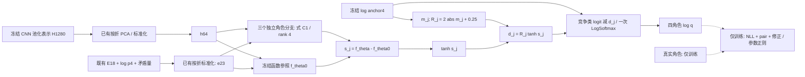

# 候选方法节：间隔缩放预算的角色残差证据网络

日期：2026-10-30。本文是论文方法章的候选补充，不是新的模型规格或可执行协议。结构与参数沿用已归档 MSB-RRE v1；本轮只读源码和文献/实验记录，未读取真实输入、运行前向或训练。下述解析证明属于作者侧推导与核对，不是独立同行评审，也不构成原创性查新完成声明。真实机制效果尚未验证，不进入主论文的性能摘要。

## 1. 研究问题与设计依据

已有研究区分出三个问题：监督目标是否与最终风险一致、输出空间是否允许纠错、视觉证据是否能学会正确修正。RSG 的标签相关软目标 BCE 不必最小化条件融合 NLL，见[理论附录 A.4b](theoretical_appendix.md)。TC 与 ABMP 的开发则说明，即使保护约束正确，固定端点之间也可能没有新增目标命中的容量。IC 的离线审计进一步发现旧预算排除了 108 个锚点错误中的 92 个。这个计数只对应已暴露的 340-fit 开发组，不是原固定测试集性能。

MSB-RRE 因此研究一个有限问题：在既有冻结视觉表示上，能否通过角色相关的非线性证据修正成对判别间隔，并使实际净纠错优于可靠普通修正头？它是后端网络候选，不改造 EfficientNet-B0 的 MBConv，不新增传感器或真实选矿阶段变量。低秩双线性融合已有先例 [1]，受约束的概率后处理也已有研究 [2]；本节不以其中任一构件单独宣称首创。

## 2. 计算图与训练目标

四角色依次为目标代理类 $T$、含钛干扰 $Ti$、脉石 $G$、金属光泽干扰 $M$。输入为冻结视觉特征 $h\in\mathbb R^{64}$、既有专家证据 $e\in\mathbb R^{23}$ 和严格正的四类锚点后验 $\bar p$。$h$ 来自既有 CNN 池化表示及按折 PCA，$e$ 来自既有 E18、四列 log 概率和一列矛盾量；这些是同一图像的表征，不是新的物理多模态数据。PCA、标准化和温度锚点均复用，不在本轮拟合。

对 $j\in\{Ti,G,M\}$，使用三个不共享可训练参数的秩 $r=4$ 分支：

$$
f_{\theta_j}(h,e)=\frac{1}{\sqrt r}a_j^\top
\big[\tanh(U_jh+u_j)\odot\tanh(V_je+v_j)\big]+\zeta_j,
\qquad s_j=f_{\theta_j}(h,e)-f_{\theta_{j,0}}(h,e).
\tag{C1}
$$

$U_j\in\mathbb R^{4\times64}$、$V_j\in\mathbb R^{4\times23}$，其余向量宽度为 4，$\zeta_j$ 为标量。$f_{\theta_{j,0}}$ 是初始化时复制的固定函数，不是对当前函数作停止梯度。初始 $s_j=0$，但当前参数的导数没有因此消失。每分支 361 个参数，共 1083 个可训练参数及 1083 个固定参照标量；该计数不包含冻结 CNN 或缓存。

定义间隔与预算：

$$
m_j=\log\frac{\bar p_T}{\bar p_j},\quad
R_j=\gamma|m_j|+\tau,\quad
d_j=R_j\tanh s_j,\qquad \gamma=2,\ \tau=0.25.
\tag{C2}
$$

这里 $m_j,R_j,d_j$ 均为对数赔率尺度；给定输入时 $R_j$ 固定，不是另一个学习头。统一输出为

$$
z_T=\log\bar p_T,\quad z_j=\log\bar p_j-d_j,\quad q=\operatorname{softmax}(z),
\quad M_j:=\log\frac{q_T}{q_j}=m_j+d_j.
\tag{C3}
$$

三个分支通过一次共同归一化形成四类后验，不能将三个独立二分类概率直接拼接。

图 C1 是与公式对应的 Markdown/Mermaid 结构源，不是新生成或本轮已渲染验收的论文位图。`scripts/msb_role_model.py` 的 `RoleBranch._score` 对应 C1，`anchor_margins` 对应 C2，`MSBRoleModel.forward` 与 `decode_role` 对应 C3。图中冻结 CNN 不是本轮重新执行的模块。

对 $I_j=\{i:y_i\in\{T,j\}\}$，令目标标签 $a_{ij}=1$、竞争角色标签 $a_{ij}=-1$。在每个 $I_j$ 非空时，既有损失为

$$
L_{pair}=\frac13\sum_j\frac1{|I_j|}\sum_{i\in I_j}
\operatorname{softplus}(-a_{ij}M_{ij}),
$$
$$
L=-\frac1N\sum_i\log q_{i,y_i}+0.1L_{pair}
+\frac{0.01}{3N}\sum_{i,j}\left(\frac{d_{ij}}{R^{ref}_{ij}}\right)^2
+\frac{0.001}{2}\sum_j\|\theta_j-\theta_{j,0}\|_2^2,
\quad R^{ref}_{ij}=2|m_{ij}|+0.25.
\tag{C4}
$$

成对损失使用主输出的相同间隔，不提供额外真值信息。普通对照和半径消融使用相同 $R^{ref}$ 定义修正惩罚，避免同时改变预算和惩罚尺度。以上系数沿用既有规格，不因本次推导而调参。

## 3. 命题 C1：跨界条件与统一内部控制

**条件。** 固定输入，$m\in\mathbb R$、$R>0$，分数 $s$ 可取任意有限实数。以下是输出坐标的可达性分析，不预设共享网络可以同时实现所有样本的分数。

对 $M=m+R\tanh s$，其值域为开区间 $(m-R,m+R)$。因此，有限分数能够使 $M$ 分别取严格正值和严格负值，当且仅当

$$
R>|m|.
\tag{C5}
$$

在 $R=\gamma|m|+\tau$、$\gamma\ge0$、$\tau>0$ 下，该条件对任意有限 $m$ 成立，当且仅当 $\gamma\ge1$。若 $0\le\gamma<1$，取 $|m|\ge\tau/(1-\gamma)$ 即得到不能严格跨界的反例。

更强地，要求存在一个与 $m$ 无关的有限控制上界 $S$，对任意 $m$ 都能在 $|s|\le S$ 内取得两种符号，则其充要条件是 $\gamma>1$。证明如下。

当 $\gamma>1$，取 $c=\tanh s=\pm1/\gamma$，则

$$
m+R/\gamma=m+|m|+\tau/\gamma\ge\tau/\gamma,
\qquad m-R/\gamma\le-\tau/\gamma.
\tag{C6}
$$

故 $S=\operatorname{atanh}(1/\gamma)$ 足够。反之，任意有限 $S$ 对应 $\kappa=\tanh S<1$。若 $\gamma\le1$，则 $\kappa\gamma<1$；当 $u>\kappa\tau/(1-\kappa\gamma)$ 时，$u-\kappa(\gamma u+\tau)>0$，以 $m=u$ 为例就无法在给定控制范围内取得负值。证毕。

特别地，$\gamma=1$ 仍允许每个有限输入跨界，但边界分数
$s^*=\operatorname{atanh}[-m/(|m|+\tau)]$ 的绝对值随 $|m|$ 趋于无穷，因而没有统一有限控制上界。$\tau=0,m=0$ 时严格正间隔见证失效，故不能省略正偏置条件。

**四类推论。** 当 $\gamma>1$ 时，令三个 $c_j=1/\gamma$，目标类同时以至少 $\tau/\gamma$ 的间隔胜出。若指定非目标类 $j$，令 $c_j=-1/\gamma$、其余 $c_k=1/\gamma$，则

$$
\log(q_j/q_T)=-m_j+|m_j|+\tau/\gamma\ge\tau/\gamma,
$$
$$
\log(q_j/q_k)=m_k-m_j+|m_j|+|m_k|+2\tau/\gamma
\ge2\tau/\gamma.
\tag{C7}
$$

这说明逐图输出空间没有预先排除任何类别。三个常数 bias 就能实现“将所有图像推向同一指定类”的见证，因此该推论不能证明视觉交互有用，也不能证明不同标签可被同一有限网络同时正确拟合。推理时不使用真值选择符号。

## 4. 命题 C2：边界控制导数的紧下界

对实数模型、固定输入、$\gamma\ge1,\tau>0$，在 $M=0$ 处有 $\tanh s^*=-m/R$。令 $u=|m|$，则

$$
\left.\frac{\partial M}{\partial s}\right|_{M=0}
=R-\frac{m^2}{R}
=\tau+\frac{(\gamma^2-1)u^2+\gamma\tau u}{\gamma u+\tau}
\ge\tau.
\tag{C8}
$$

证明由代入 $R=\gamma u+\tau$ 并通分直接得到。分子两项非负，且 $u=0$ 时取等号，所以 $\tau$ 是对全部有限 $m$ 的紧下界。当前 $\gamma=2,\tau=0.25$ 下，C8 将原规格的较松下界 $\tau(1-\gamma^{-2})=0.1875$ 收紧为 $0.25$；未改变网络或预算。

因 $\partial s_j/\partial\zeta_j=1$，对单个成对样本的未缩放 logistic 损失有

$$
\left|\frac{\partial\operatorname{softplus}(-aM)}{\partial\zeta_j}\right|_{M=0}
=\frac12\left(R-\frac{m^2}{R}\right)\ge\tau/2.
\tag{C9}
$$

**适用边界。** C8/C9 不是全部参数的梯度下界。批次中异号梯度、其他损失和正则项可以抵消；成对相等也可能发生在第三类占优的区域，不一定对应四类获胜边界。浮点饱和、下溢或非法概率不由实数证明排除。该命题不保证优化速度、收敛、召回或来源外泛化。

## 5. 可解释功能量与不可混淆的创新主张

给定锚点后验，修正量由输出唯一确定：

$$
d_j=\log(q_T/q_j)-\log(\bar p_T/\bar p_j).
\tag{C10}
$$

独立分支意味着固定输入时 $\partial M_k/\partial\theta_j=0$（$k\ne j$），但共同归一化仍会改变全部绝对概率。C10 只识别输出功能量，不识别唯一参数、因果机制或真实矿物属性；普通残差头也具有该恒等式，因此不列为第三项独占原创定理。

共享双线性对照可通过分块参数嵌入完整表示主模型。故本文不能主张角色分支比该对照表达能力更强。待验证问题仅是相同输入与公平训练条件下，角色分支的结构约束是否带来额外净纠错。相对于线性/可分加性头的混合导数差异，也不能替代与普通非线性网络的比较。

扩大半径同时扩大有益和有害修正的可达范围。C6/C7 的同一见证既能纠正错误，也能把原本正确的图像推向错误类别，不能据此宣称“保护一切高置信正确预测且纠正任意高置信错误”。

## 6. 证据与有限验证边界

| 主张 | 当前支持 | 尚缺证据 |
|---|---|---|
| 固定凸路由存在分类容量限制 | 已有解析论证及 ABMP 开发记录 | 不外推为所有融合网络的限制 |
| MSB 允许统一有限控制跨界 | C1 的实数证明、既有结构实现 | 不说明训练能实现有益的样本相关分数 |
| 边界导数下界可收紧至 $\tau$ | 本节 C2 解析证明与源码公式核对 | 本轮未重跑数值检查，未进行独立数学复查 |
| 角色视觉证据优于普通修正 | 尚无真实 MSB 效果证据 | 公平强对照下的净纠错、误入与总体性能 |
| 泛化与应用价值 | 既有 RSG 结果另按其协议报告 | MSB 独立确认及真实矿石验证均不能预设已完成 |

本次文稿修订不生成或变更运行协议。既有候选矩阵为 11 单元、最多 75 次轻量拟合、7200 秒累计上限；实际运行仍需另行批准。主点、强对照与失败标准不得在查看结果后调整。只有 NLL 微动、非零梯度或胜过旧受限预算，均不足以晋级角色机制；失败不自动触发新网络版本或扩网格。若开发通过，仍须核实未暴露确认数据的可用性，不能将既有 340-fit/已暴露 stop 称为独立测试。

## 来源与文献边界

- [MSB 原规格](../superpowers/specs/2026-10-14_margin_scaled_bilinear_role_evidence_design.md)：本节继承结构与系数，新增的是 C1 条件分类及 C2 收紧证明；原规格不在本轮改写。
- [IC 离线理论审计](../experiment_records/2026-10-14_ic_role_offline_theory_audit.md)：旧输出预算的能力限制，不能当作 MSB 的效果。
- [ABMP 开发与理论诊断](../experiment_records/2026-10-01_abmp_rsg_v2_development.md)：固定凸路由容量证据。
- [1] *Hadamard Product for Low-rank Bilinear Pooling*. arXiv:1610.04325，2016 年首发，2017 年修订。https://arxiv.org/abs/1610.04325 。用于确认低秩 Hadamard 交互已有先例，不据此声称与本网络整体等价。
- [2] *Probability Bounding: Post-Hoc Calibration via Box-Constrained Softmax*. arXiv:2506.10572，2025 年首发。https://arxiv.org/abs/2506.10572 。本次有限查新核对了元数据与摘要，不能据此判断全文理论与本方法的全部异同。

本节不使用“首次”“一般风险一致性”“全局收敛”或“已验证识别提升”。明确的公式、成立条件和反例提升论证质量，但其文献原创性与实际角色学习效果仍是不同的待证问题。
