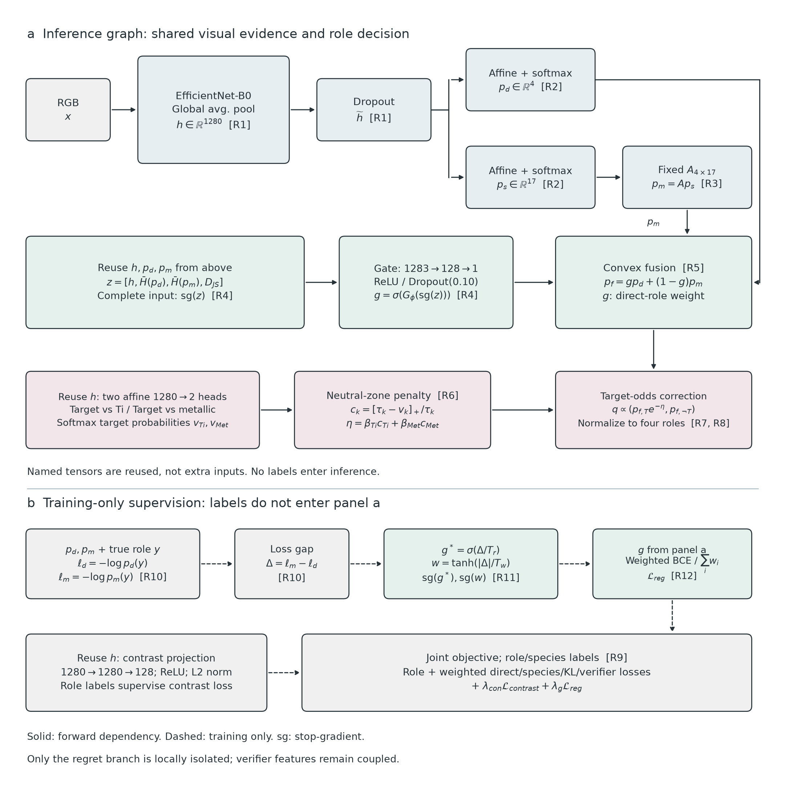
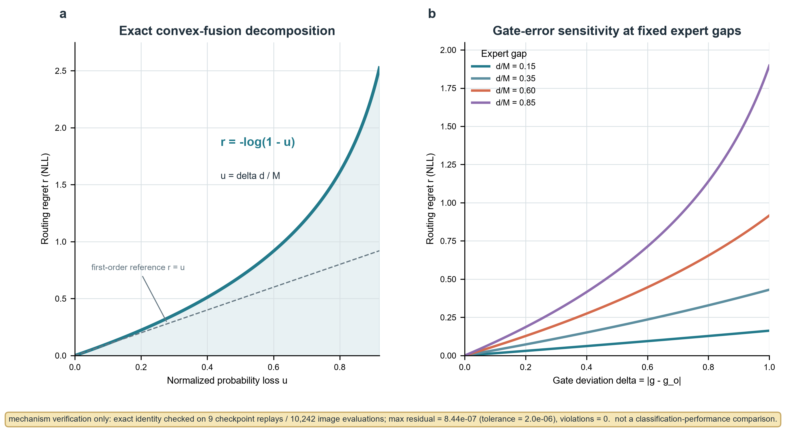
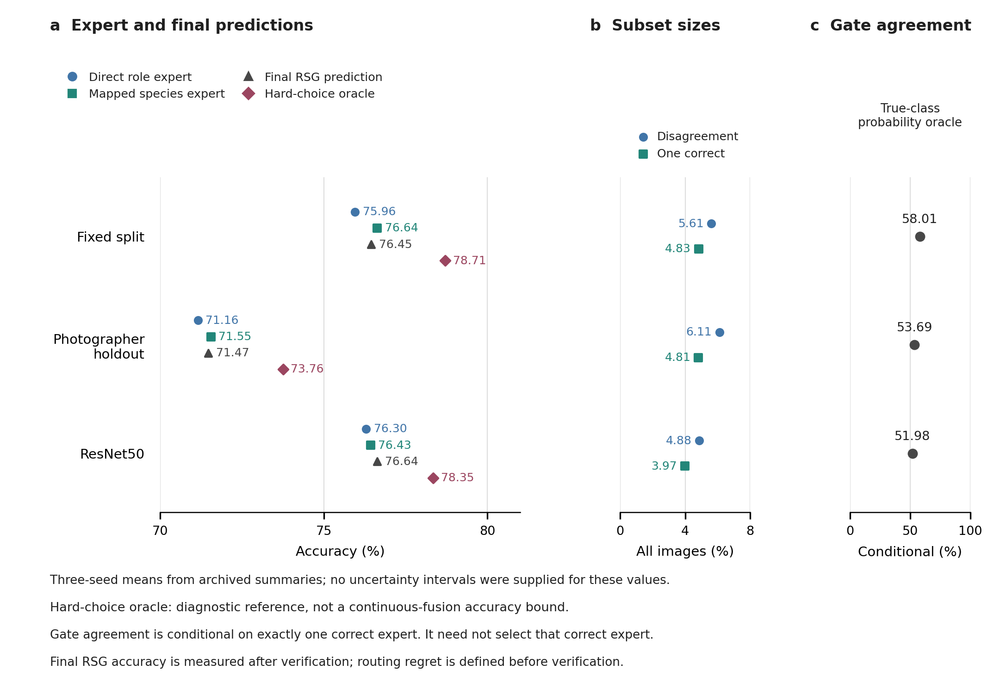
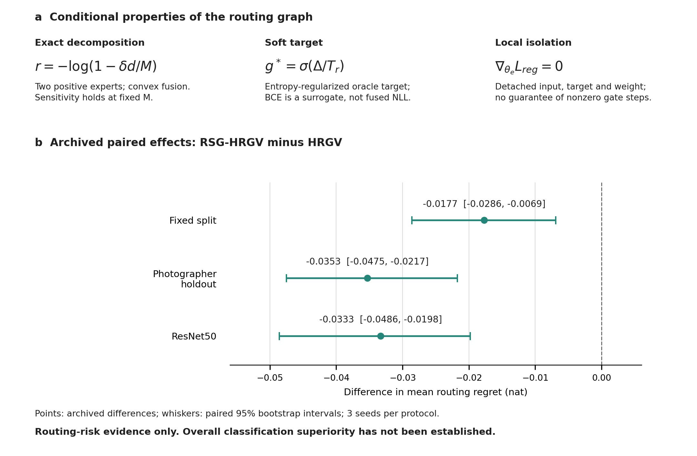

# Regret-Supervised Cross-Granularity Routing for Visual Role Recognition of Vanadium-Titanium-Related Minerals

> English working draft, 15 November 2026. Provisional target: Minerals, Article. Not submission-ready. Author metadata, historical implementation gaps, reference review, and journal-format checks remain open in [README](README.md). This is an evidence-preserving adaptation of the Chinese manuscript, not a new experiment or a replacement for the official technical report.

**Authors:** [AUTHOR INPUT REQUIRED: names, order, affiliations, corresponding author and email]

## Abstract

Public mineral photographs contain heterogeneous backgrounds and visually similar minerals, making the reliability of classification evidence difficult to assess. We study cross-granularity routing for four visual proxy roles using 8,529 images with seventeen mineral-species labels. A Regret-Supervised Hierarchical Risk-Gated Verification Network (RSG-HRGV-Net) combines a direct role expert with a species-to-role expert. Training-time expert loss differences supply soft routing targets, while two verifiers regulate target acceptance. Conditional analysis relates routing regret to gate deviation and expert probability separation and distinguishes routing improvement from classification improvement. Against a matched reference, three-seed experiments reduced mean routing regret by 0.0177 nat (95% paired cluster-bootstrap interval: -0.0286 to -0.0069). The reduction persisted under photographer holdout (-0.0353 nat) and a ResNet50 backbone (-0.0333 nat). Fixed-split accuracy was 76.45% and macro F1 was 74.76%, but their paired differences did not establish stable overall classification gains. Component analyses exposed trade-offs between interference rejection and target recall. These results support a bounded routing mechanism for public specimen images, rather than a new convolutional backbone or validated industrial sorting performance.

**Keywords:** mineral image recognition; vanadium-titanium-related minerals; hierarchical classification; mixture of experts; regret supervision; hard negatives

## 1. Introduction

Visual mineral recognition can assist the organization and interpretation of specimen photographs, but its output should not be confused with chemical composition or recoverable value. In vanadium-titanium-related mineral collections, dark target minerals can resemble titanium-bearing or metallic-luster interference minerals. A model may also respond to associated minerals, matrix material, or photographic background. We therefore consider a closed-set visual proxy task rather than ore-grade estimation or operational sorting.

Public mineral-image studies already address several of these challenges. Wu et al. studied multi-label mineral identification from images containing associated minerals [1]. Ji et al. combined image features with out-of-distribution detection to distinguish known and unknown minerals [2]. MineralImage5k addressed raw-specimen recognition and description [3], whereas Zhang et al. investigated multi-view evolutionary feature fusion for iron-ore images [4]. Their tasks differ in labels, acquisition conditions and evaluation protocols; published accuracies are not directly comparable with the present four-role task.

Our question concerns evidence selection within one network. A classifier trained directly on coarse visual roles and a classifier trained on mineral species can induce different role probabilities for the same image. Which evidence should receive more weight, and does better evidence selection necessarily improve the final class prediction? Expert gating is not itself new: it is central to mixtures of experts [5], and recent work includes hierarchical and context-responsive routing [6,7] and regret-based model routing across source domains [8]. The contribution here is the task-specific supervision and diagnosis of two semantic granularities, not the invention of experts, gates, or regret.

We investigate a Regret-Supervised Hierarchical Risk-Gated Verification Network (RSG-HRGV-Net). A shared convolutional representation supports a direct four-role expert and a seventeen-species expert mapped into the same four-role space. The gate receives training-only soft targets derived from the experts' true-class losses. Two local verifiers and a neutral-zone posterior correction address target confusion with titanium-bearing and metallic-luster interference. We analyze the routing objective separately from the final classification objective.

The study makes three bounded contributions. First, it organizes cross-granularity evidence and targeted verification in a shared network with explicit routing supervision. Second, it derives conditional relationships between routing regret, gate deviation and expert separation, together with limits on their classification implications. Third, it tests these mechanisms using matched three-seed comparisons, photographer holdout, a second convolutional backbone and component ablations. The main empirical finding is lower predefined routing regret; stable overall classification superiority and stronger network expressivity are not established.

## 2. Materials and Methods

### 2.1. Images, Labels and Evaluation Protocols

The dataset contains 8,529 public mineral-specimen images from the Mindat ecosystem. Seventeen species labels are mapped to four visual roles: target proxy minerals, titanium-bearing interference, gangue/waste-rock proxies, and metallic-luster interference. The target role includes ilmenite, titanomagnetite and ordinary magnetite proxy samples. Ordinary magnetite is not treated as confirmed titanomagnetite. These roles are fixed labels for this study, not universal economic or process-stage assignments; a mineral described as interference here may be valuable under another process.

Source pages, photo identifiers, species names and screening decisions are retained. Exact duplicates and near-duplicates are grouped using SHA-256, Mindat photo identifiers and perceptual hashes. The fixed split contains 5,961 training, 1,284 validation and 1,284 test images, with duplicate groups confined to one split. Augmentation is applied only during training. Screening addresses unclear subjects, excessive mineral mixtures, severe blur or exposure problems, and unsuitable imaging modes. Residual ambiguity remains because a page label need not identify the only visible mineral. The audit trail does not establish that every image received expert mineralogical confirmation.

A separate photographer-holdout protocol uses 5,639 images with photographer metadata and splits them into 3,947/846/846 training/validation/test images. The 2,890 images without that field are excluded from this protocol. Photographer identities and duplicate-group identifiers do not overlap between splits. This tests transfer across photographic sources within the same image ecosystem, not across websites, mines or industrial installations.

Fixed-split and second-backbone comparisons use seeds 20260727, 20260728 and 20260729. Photographer-holdout confirmation uses 20260727, 20260729 and 20260730; its development seed 20260728 is excluded from that formal estimate. The fixed test set also informed historical error analysis, so its results are not presented as a previously untouched prospective confirmation. Development diagnostics and their exposure status remain separately archived.

### 2.2. Cross-Granularity Experts and Gate

Figure 1 shows the model's inference and training paths. EfficientNet-B0 [9] provides pooled features; a matched ResNet50 [10] experiment tests portability of the routing mechanism. For the EfficientNet-B0 configuration,

$$
h=f_\theta(x)\in\mathbb{R}^{1280},\qquad \widetilde h=\operatorname{Dropout}(h).
\tag{R1}
$$

Two affine heads with biases produce direct role and species probabilities:

$$
p_d(\cdot\mid x)=\operatorname{softmax}(W_d\widetilde h+b_d),\qquad
p_s(\cdot\mid x)=\operatorname{softmax}(W_s\widetilde h+b_s).
\tag{R2}
$$

The fixed mapping $A\in\{0,1\}^{4\times17}$ has one nonzero entry per column and induces

$$
p_m(\cdot\mid x)=A p_s(\cdot\mid x).
\tag{R3}
$$

Let $\bar H(p)=-\sum_jp_j\log p_j/\log4$ be normalized entropy and let $D_{\mathrm{JS}}$ denote Jensen-Shannon divergence with midpoint $(p_d+p_m)/2$. The gate receives pooled features and three reliability descriptors:

$$
z=\left[h,\bar H(p_d),\bar H(p_m),D_{\mathrm{JS}}(p_d\Vert p_m)\right],\qquad
g(x)=\sigma\!\left(G_\phi(\operatorname{sg}(z))\right).
\tag{R4}
$$

Here $\operatorname{sg}$ is stop-gradient. The gate has dimensions $1283\to128\to1$, with ReLU, dropout of 0.10 and sigmoid. Its output weights the direct expert:

$$
p_f(y\mid x)=g(x)p_d(y\mid x)+[1-g(x)]p_m(y\mid x).
\tag{R5}
$$

Stopping gradients changes training dependencies, not forward values. Relative to the matched HRGV reference, RSG preserves the inference topology and changes supervision and gate-input gradient flow. It is not a new convolutional operator or an established enlargement of the inference function class.

**Figure 1.** Regret-Supervised Hierarchical Risk-Gated Verification Network (RSG-HRGV-Net). Panel a shows inference through direct and mapped experts, convex fusion and verifier correction. Panel b shows training-only labels, loss-gap targets and auxiliary losses. Solid arrows denote forward dependencies and dashed arrows training-only supervision. Repeated tensor names reuse the same outputs. Stop-gradient applies to the complete gate input, regret targets and weights; verifier features remain coupled to the backbone. R1-R12 identify the corresponding equations; the figure abbreviates R12, whose clipping and zero-weight conventions are given below. No true label enters inference.

### 2.3. Targeted Verification

Two binary affine heads, each $1280\to2$, estimate target probabilities $v_{Ti}$ and $v_{Met}$ on the target-versus-titanium and target-versus-metallic role subsets. For a verifier indexed by $h$, define

$$
c_h(v_h)=\frac{[\tau_h-v_h]_+}{\tau_h},\qquad
\eta(x)=\beta_{Ti}c_{Ti}(v_{Ti})+\beta_{Met}c_{Met}(v_{Met}),\qquad
\tau_h\in(0,1],\ \beta_h\ge0.
\tag{R6}
$$

With $T$ denoting the target role, the final posterior is

$$
q_T=\frac{p_{f,T}e^{-\eta}}{p_{f,T}e^{-\eta}+\sum_{j\ne T}p_{f,j}},
\tag{R7}
$$

$$
q_j=\frac{p_{f,j}}{p_{f,T}e^{-\eta}+\sum_{\ell\ne T}p_{f,\ell}},\qquad j\ne T.
\tag{R8}
$$

If both verifiers reach their neutral thresholds, $\eta=0$ and $q=p_f$. Otherwise, target odds are reduced. This is a directional risk adjustment, not a guarantee of correct rejection: an erroneous verifier can suppress a genuine target. Non-target relative odds are unchanged. Supporting identities are given in Supplementary Note S2.

### 2.4. Joint Objective and Regret Supervision

The joint objective is

$$
\mathcal L=\mathcal L_{role}
+\lambda_d\mathcal L_{direct}
+\lambda_s\mathcal L_{species}
+\lambda_c\mathcal L_{KL}
+\lambda_v(\mathcal L_{Ti}+\mathcal L_{Met})
+\lambda_{con}\mathcal L_{contrast}
+\lambda_g\mathcal L_{reg}.
\tag{R9}
$$

The first three terms supervise the final posterior and the two expert heads using inverse-frequency class weighting. The consistency term is the batch mean of $D_{\mathrm{KL}}(p_m\Vert p_d)$. Each verifier is supervised only on its relevant binary subset. A normalized projection $1280\to1280\to128$ supplies a contrastive term restricted to target-versus-titanium and target-versus-metallic relations. Its numerator sums positive probability mass before taking the logarithm; it is not the average of separate positive-pair log losses. The exact batch definitions, masks and empty-set conventions are provided in Supplementary Note S1.

For the true role $y$, define training-time expert losses and their difference:

$$
\ell_d=-\log p_d(y\mid x),\qquad
\ell_m=-\log p_m(y\mid x),\qquad
\Delta=\ell_m-\ell_d.
\tag{R10}
$$

The soft gate target and bounded gap weight are

$$
g^*=\sigma(\Delta/T_r),\qquad
w=\tanh(|\Delta|/T_w),\qquad T_r,T_w>0.
\tag{R11}
$$

Let $W_{\mathcal B}=\sum_{i\in\mathcal B}\operatorname{sg}(w_i)$ and $\widetilde g_i=\operatorname{clip}(g_i,\varepsilon_{\mathrm{num}},1-\varepsilon_{\mathrm{num}})$. The implemented batch loss is

$$
\mathcal L_{reg}^{\mathcal B}=
\begin{cases}
\dfrac{\sum_{i\in\mathcal B}\operatorname{sg}(w_i)
\operatorname{BCE}(\widetilde g_i,\operatorname{sg}(g_i^*))}{W_{\mathcal B}},
& W_{\mathcal B}>\varepsilon_{\mathrm{num}},\\
0,&W_{\mathcal B}\le\varepsilon_{\mathrm{num}}.
\end{cases}
\tag{R12}
$$

The numerical floor depends on the implementation dtype. The target approaches one when the direct expert assigns the true role greater probability, and zero when the mapped expert does. Gap weighting reduces supervision for nearly equivalent experts. Both targets and weights are detached, as is the complete gate input. Other task losses continue to train the shared representation. A batch-normalized expectation must not be silently replaced by a population ratio of expectations.

### 2.5. Conditional Routing Analysis

For one labelled sample, let $a=p_d(y\mid x)$, $b=p_m(y\mid x)$, $a,b\ge\varepsilon>0$, $g_o=\mathbf1[a\ge b]$, $M=\max(a,b)$, $d=|a-b|$ and $\delta=|g-g_o|$. The probability oracle $g_o$ uses the true label and is diagnostic, not deployable. For $p_g=ga+(1-g)b$,

$$
p_g=M-\delta d,\qquad
r=-\log p_g+\log M=-\log(1-\delta d/M),\qquad
0\le r\le\delta d/\varepsilon.
\tag{T1}
$$

The identity follows by considering $a\ge b$ and $a<b$ separately. The bound follows from the derivative bound $|(-\log t)'|\le1/\varepsilon$ on $[\varepsilon,1]$. This links routing regret to gate deviation and normalized expert separation. For fixed $M$ and feasible $\delta d<M$, regret is nondecreasing in either factor with the other fixed; absolute separation alone does not order regret across samples whose $M$ differs. Nor does this bound uniquely derive or optimize the chosen tanh weight.

For $\Delta\ne0$, the sigmoid target satisfies

$$
|g^*-g_o|=\frac{1}{1+e^{|\Delta|/T_r}}
\le e^{-|\Delta|/T_r}.
\tag{T2}
$$

It approaches hard expert selection when evidence is well separated and stays continuous near a tie. This is a standard sigmoid property applied to the present supervision, not a new universal consistency theorem.

Finally, suppose the gate parameters $\phi$ are not shared with the expert or backbone parameters $\theta_e$. Detaching the complete gate input, target and weight gives

$$
\nabla_{\theta_e}\mathcal L_{reg}=0.
\tag{T3}
$$

This is a local computational-graph property. It neither freezes the backbone under the other losses nor guarantees a nonzero gate-parameter gradient at every step. Detaching only targets and weights would leave the gate-input path open.

Routing regret is not classification regret. Even with fixed experts, the optimum of a label-weighted soft-target objective need not minimize conditional fused negative log-likelihood (NLL). Supplementary Note S3 gives the existing analytical counterexample and distinguishes the population objective from the implemented batch loss. We use T1-T3 to explain measurable mechanisms, not to promise generalization or class-accuracy improvements.

**Figure 2.** Analytical relationship between $u=\delta d/M$ and $r=-\log(1-u)$, with $r=u$ as a first-order reference, and sensitivity to gate deviation at four fixed $d/M$ ratios. NLL differences on the vertical axis use natural logarithms and are measured in nat. Annotations summarize nine previously archived checkpoint replays containing 10,242 image evaluations: the maximum identity residual was $8.44\times10^{-7}$ against tolerance $2\times10^{-6}$. The curves illustrate the equation; replay checks establish finite-precision consistency, not new accuracy evidence.

### 2.6. Implementation and Statistical Analysis

Eighteen archived environment records cover the two matched methods, three seeds and three protocols. The gate hidden dimension and contrastive embedding dimension are 128. Coefficients are $\lambda_d=0.25$, $\lambda_s=0.50$, $\lambda_c=0.10$, $\lambda_v=0.50$, $\lambda_{con}=0.10$ and $\lambda_g=0.10$. Temperatures are $T_r=0.20$, $T_w=0.50$ and $T_{con}=0.10$. Both verifier thresholds are 0.50 and both penalty strengths are one. Verifier features remain coupled to the backbone. The matched HRGV reference sets $\lambda_g=0$ and does not detach the gate input; therefore, the main comparison evaluates a training strategy with two changed settings, not the causal effect of one loss term alone.

The inspected records identify CUDA execution and PyTorch 2.12.1+cu130. They do not establish every historical batch size, optimizer setting, input-transform parameter, GPU model or full dependency lock. Current source defaults and later hardware records are not substituted for those missing values. The [reproducibility record](../reproducibility_materials.md) distinguishes recorded parameters from remaining gaps. Exact run-by-run reconstruction is therefore not yet established.

Accuracy, macro F1, target recall and class-specific interference-to-target rates are computed from final predictions $q$. Each interference rate uses the corresponding true interference class as its denominator; it is not contamination among accepted targets. Routing regret is measured before verification on $p_f$, in nat. The probability-oracle agreement metric compares $\mathbf1[g\ge0.5]$ with $g_o$ only among images where exactly one expert's argmax prediction is correct. It does not necessarily measure selection of the classification-correct expert. A separate hard expert-choice accuracy oracle uses the union of expert-correct events and is not a universal upper bound for continuous fusion or the verified final network.

Results report three-seed means and sample standard deviations. Paired effects are calculated within seeds and then averaged. The archived two-stage bootstrap first resamples three seeds with replacement, then resamples duplicate-image groups with replacement within true-role strata for each sampled seed. Both models share each draw and all images in a sampled group remain together. Metrics are computed per sampled seed before averaging; predictions are not pooled as three times as many independent images. Intervals are the 2.5th and 97.5th percentiles. Fixed-split, photographer-holdout and second-backbone routing comparisons use 2,000, 5,000 and 2,000 resamples, respectively. Three seeds give limited information about training variability. Photographer holdout is a split design, not photographer-level bootstrap sampling, and these intervals are not guarantees for new industrial domains. Component intervals are not presented as multiplicity-adjusted simultaneous tests.

## 3. Results

### 3.1. Fixed-Split Routing and Final Classification

RSG-HRGV reduced mean routing regret relative to matched HRGV, while overall classification differences remained uncertain (Table 1). The regret difference was -0.0177 nat, with a 95% interval of [-0.0286, -0.0069]. Accuracy, macro F1, target recall and the two interference-rate intervals crossed zero. Conditional probability-oracle agreement increased by 12.02 percentage points in the three-seed means, but this metric is not a direct count of classification corrections.

**Table 1.** Fixed-split comparison. RSG: regret-supervised gating; HRGV: hierarchical risk-gated verification. Entries are mean +/- sample standard deviation across three seeds. Classification columns and oracle agreement are percentages; routing regret is in nat. T denotes the target proxy role; Ti and Met denote the two interference roles. Agreement is conditional on exactly one expert being classification-correct.

| Method | Accuracy | Macro F1 | Target recall | Ti to T | Met to T | Probability-oracle agreement | Routing regret / nat |
|---|---:|---:|---:|---:|---:|---:|---:|
| HRGV | 76.48 +/- 0.23 | 74.59 +/- 0.34 | 72.38 +/- 3.22 | 9.16 +/- 1.13 | 11.55 +/- 1.18 | 45.99 +/- 4.82 | 0.0986 +/- 0.0096 |
| RSG-HRGV | 76.45 +/- 0.98 | 74.76 +/- 0.90 | 72.91 +/- 1.38 | 8.42 +/- 1.54 | 11.17 +/- 0.87 | 58.01 +/- 1.76 | 0.0809 +/- 0.0017 |

The direct expert, mapped expert and final RSG output obtained fixed-split mean accuracies of 75.96%, 76.64% and 76.45%, respectively. Their hard expert-choice accuracy oracle was 78.71%. The experts disagreed in argmax class on 5.61% of images, and exactly one expert was correct on 4.83%. This leaves a limited disagreement subset for routing diagnosis and does not establish superiority over the mapped expert. Figure 3 separates expert performance, final performance and oracle diagnostics rather than treating them as interchangeable evidence.

**Figure 3.** Three-seed summaries of expert and final accuracies, expert disagreement, and conditional agreement with the true-class-probability oracle. The hard expert-choice accuracy oracle uses true labels and cannot be deployed. It is not an upper bound for every continuous fusion. The conditional agreement panel is not the proportion of classification-correct expert selections. Final accuracy is measured after verification. Corresponding uncertainty intervals were not present in the source summaries and are not reconstructed here.

### 3.2. Photographer Holdout and Backbone Portability

Under photographer holdout, routing regret decreased by 0.0353 nat, with a 95% interval of [-0.0475, -0.0217] (Tables 2 and 3). Macro F1 and target recall increased in mean, but their intervals crossed zero. Metallic-interference acceptance increased from 11.88% to 14.19%, illustrating that a routing improvement does not imply uniformly better role decisions.

**Table 2.** Photographer-holdout comparison. Units and aggregation match Table 1; its three formal seeds differ from the fixed-split protocol as specified in Section 2.1.

| Method | Accuracy | Macro F1 | Target recall | Ti to T | Met to T | Probability-oracle agreement | Routing regret / nat |
|---|---:|---:|---:|---:|---:|---:|---:|
| HRGV | 71.20 +/- 0.69 | 68.99 +/- 1.17 | 71.25 +/- 6.31 | 12.69 +/- 1.83 | 11.88 +/- 3.96 | 45.19 +/- 8.34 | 0.1177 +/- 0.0063 |
| RSG-HRGV | 71.47 +/- 1.14 | 69.25 +/- 0.99 | 72.04 +/- 2.64 | 11.40 +/- 2.10 | 14.19 +/- 3.02 | 53.69 +/- 4.02 | 0.0824 +/- 0.0080 |

The matched ResNet50 comparison reproduced the direction of the routing effect, with a difference of -0.0333 nat and a 95% interval of [-0.0486, -0.0198]. This is evidence for the mechanism on a second convolutional backbone, not proof of performance gains on arbitrary architectures. Across separately trained models, the reference expert probabilities also change; these effect sizes do not isolate a fixed-expert gate improvement or directly measure absolute NLL improvement.

**Table 3.** Mean routing-regret differences, RSG minus matched HRGV. Each protocol has three seeds. These protocol-specific estimates are not pooled into a common effect.

| Protocol | Difference / nat | 95% paired interval / nat | Bootstrap resamples |
|---|---:|---|---:|
| Fixed split, EfficientNet-B0 | -0.0177 | [-0.0286, -0.0069] | 2000 |
| Photographer holdout, EfficientNet-B0 | -0.0353 | [-0.0475, -0.0217] | 5000 |
| Fixed split, ResNet50 | -0.0333 | [-0.0486, -0.0198] | 2000 |

**Figure 4.** Conditional routing properties and archived paired routing-regret effects. Points show RSG minus HRGV and bars show the existing 95% paired cluster-bootstrap intervals, in nat. The fixed-split, photographer-holdout and second-backbone comparisons used 2,000, 5,000 and 2,000 resamples. These results do not establish overall classification superiority, a loss-only causal effect, or priority over all previous routing theory.

### 3.3. Component Contributions and Trade-offs

The HRGV ablations distinguish evidence organization from verification effects (Table 4). Removing the role-aware contrast term reduced mean accuracy and macro F1. For complete HRGV minus this ablation, paired differences were 1.09 percentage points in accuracy (95% interval [0.08, 2.15]) and 1.08 points in macro F1 ([0.12, 2.06]). This supports that component in the tested configuration, not superiority of all role-aware losses over every general hard-example loss.

**Table 4.** Existing HRGV component ablations on the fixed split. Values are mean +/- sample standard deviation, in percent. This table concerns the HRGV reference family, not RSG-specific component replacements.

| Configuration | Accuracy | Macro F1 | Target recall | Ti to T | Met to T |
|---|---:|---:|---:|---:|---:|
| Coupled residual HRGV | 76.48 +/- 0.23 | 74.59 +/- 0.34 | 72.38 +/- 3.22 | 9.16 +/- 1.13 | 11.55 +/- 1.18 |
| Equal-weight fusion | 75.91 +/- 0.29 | 74.01 +/- 0.33 | 73.04 +/- 2.99 | 9.78 +/- 1.47 | 12.31 +/- 2.37 |
| No role-aware contrast | 75.39 +/- 0.86 | 73.51 +/- 0.56 | 71.05 +/- 2.65 | 9.78 +/- 2.74 | 10.98 +/- 2.15 |
| Detached-verifier residual HRGV | 74.71 +/- 1.56 | 72.99 +/- 2.15 | 75.03 +/- 4.30 | 10.05 +/- 0.62 | 13.64 +/- 2.05 |
| Gate only, no verifiers | 76.74 +/- 0.65 | 74.91 +/- 0.41 | 74.37 +/- 0.83 | 9.78 +/- 1.47 | 11.74 +/- 0.87 |
| Earlier multiplicative verification | 75.91 +/- 0.83 | 74.25 +/- 1.02 | 71.05 +/- 1.80 | 9.91 +/- 1.05 | 12.12 +/- 0.87 |

Learned fusion improved mean macro F1 by 0.58 points relative to equal weights, but the corresponding paired interval crossed zero. Verification reduced mean titanium and metallic interference-to-target rates relative to gate-only prediction while reducing target recall by approximately 1.99 points. The isolated-verifier configuration increased mean recall but worsened accuracy, macro F1 and the two interference rates. These observations are compatible with a risk trade-off, not cost-free enhancement.

RSG-specific replacements further qualify the routing claim. Replacing soft targets with hard probability-oracle targets increased routing regret by 0.0194 nat (95% interval [0.0130, 0.0260]). Removing gap weights changed regret by -0.0020 nat ([-0.0062, 0.0012]); the interval did not establish a benefit from weighting. Allowing the regret branch to backpropagate through expert evidence reduced regret by 0.0051 nat (difference -0.0051; interval [-0.0085, -0.0016]), whereas macro F1 decreased by 1.58 points with an interval of [-4.10, 0.35]. The sign of the latter mean is unfavorable but its interval crosses zero. Local gradient isolation is thus an exact graph property, not a universally beneficial performance rule.

### 3.4. Formula Checks and Negative Diagnostics

Nine previously archived checkpoint replays, spanning three protocols and 10,242 image evaluations, checked the exact decomposition, regret upper bound and soft-target bound. With a float32 probability floor of $1.19\times10^{-7}$ and tolerance $2\times10^{-6}$, their maximum residuals were $8.44\times10^{-7}$, $9.41\times10^{-8}$ and $5.94\times10^{-8}$, respectively, with zero violations. The ResNet50 subset covered 3,852 evaluations. Repeated image evaluations are not 10,242 independent physical specimens. These checks corroborate numerical implementation of the conditional formulas; they do not prove novelty or statistical effectiveness.

Descriptive stratification by the local upper bound separated low- and high-regret samples. This is a mechanism diagnostic because the bound already contains the gate deviation and expert gap; it is not an independent discovery of a new error class. Fixed-expert equal-weight substitutions produced inconsistent NLL directions across nine archived comparisons, and fixed-expert gate retraining did not establish a stable overall advantage. In a separate out-of-sample routing confirmation, NLL decreased by 0.014040 nat relative to equal weights but target recall decreased by 2.476 percentage points, exceeding its preset one-point harm limit. That candidate was not promoted into the main method. These negative results constrain attribution and are retained in Supplementary Note S4 and the development archive.

## 4. Discussion

The central finding is a separation between routing quality and classification quality. Soft supervision from true-class expert losses lowered the defined routing regret across the fixed split, photographer holdout and a second backbone. Yet accuracy and macro F1 did not show a stable paired improvement. A method paper on this result should explain what its mechanism controls, rather than describe every lower intermediate loss as better mineral recognition.

Three observations help interpret this separation. First, the two experts disagreed in class on only a small fraction of images. For fixed endpoints that predict the same unique class, scalar convex fusion cannot change that class; Supplementary Note S3 states the corresponding finite-sample capacity bound. Second, the oracle is defined by true-class probability rather than argmax correctness, so improved oracle agreement need not create a correct classification. Third, verifiers modify the fused posterior afterwards and can trade reduced interference acceptance for lost target recall. Consequently, pre-verification routing and final role decisions require separate reporting.

Theoretical analysis adds explanatory precision but not a general guarantee. The exact decomposition identifies the relevant probability geometry. The sigmoid bound explains the soft target, and stop-gradient specifies which optimization path is isolated. Their mathematical validity is distinct from the empirical value of the selected weight, the capacity of a shared gate to learn samplewise targets, and the novelty of the overall construction. The conditional population counterexample further rules out a universal equivalence between soft-target supervision and fused NLL minimization. We therefore do not claim a new convergence, calibration or generalization theorem.

For mineral-image research, the task-specific contribution lies in comparing species-derived and role-level evidence under a traceable protocol. This differs from identifying all associated minerals [1], rejecting unknown species [2], or combining multiple pretrained backbones [4]. It does not replace these approaches. The four roles deliberately aggregate mineral names for a proxy recognition question; they cannot determine phase composition, grade, liberation or a plant-specific treatment action.

Several limitations remain material. The images depict public specimens rather than conveyor particles. Labels may describe a page theme rather than the dominant visible mineral. Genuine titanomagnetite coverage is limited, and ordinary magnetite is only a proxy. Photographer holdout reduces one source of dependence but does not establish cross-mine or industrial transfer. Repeated use of the historical fixed test set for diagnosis also limits a prospective interpretation of that protocol. Only three training seeds enter each formal comparison. Finally, incomplete historical training and hardware records restrict exact reproducibility; publishing code and configuration excerpts does not remove those gaps.

Stage-conditioned decisions, independent out-of-distribution evaluation and the unvalidated nonlinear residual candidates remain future research. No process-stage labels, chemical grades, recovery measurements or assay costs are available to validate such claims here. They are not included among the completed contributions of this article.

## 5. Conclusions

RSG-HRGV-Net supplies explicit regret supervision for choosing between direct role evidence and species-mapped evidence in a public mineral-image proxy task. Conditional analysis connects the gate to a measurable routing loss and explains why that loss is not interchangeable with final classification performance. Matched three-seed comparisons support lower routing regret under the fixed split, photographer holdout and a second backbone, while stable overall classification gains remain unestablished. The role-aware contrast component has supporting classification evidence within HRGV, and verification exposes a target-recall trade-off. These findings support a bounded mechanism study, not stronger convolutional expressivity, ore-grade prediction or validated industrial recovery.

## Supplementary Materials

[Supplementary Notes S1-S5](supplementary_notes_en.md) provide batch loss definitions, supporting conditional analysis, the population counterexample, development limits and reproducibility gaps. Linked Chinese records remain provenance material; a final journal upload must include self-contained supplementary files rather than depend on relative repository links.

## Author Contributions

[AUTHOR INPUT REQUIRED: assign actual CRediT roles, confirm author order and obtain approval of the final manuscript from all authors.]

## Funding

[AUTHOR INPUT REQUIRED: funding bodies, grant numbers, institutional support and publication funding. Do not infer that there was no funding.]

## Data Availability Statement

The project repository contains code, image manifests, split records and archived analysis materials: https://github.com/bobking88/4-. Raw Mindat photographs are not redistributed in this manuscript package because access and reuse depend on their source permissions. Links and metadata support provenance but do not guarantee continued availability or permission to redistribute every image. Model weights and a complete run-specific environment are not supplied by this package. [AUTHOR CHECK REQUIRED: verify the accessible artifact inventory and freeze the release identifier before submission.]

## Acknowledgments and AI Assistance

[AUTHOR CHECK REQUIRED: finalize the following disclosure after checking the complete project history.] OpenAI Codex/ChatGPT assisted with research discussions, software and documentation preparation, mathematical exposition, and manuscript drafting and translation. This assistance went beyond superficial language editing. The exact product/model versions, prompts or prompt summaries, scope of code and analysis assistance, and human verification procedures must be documented before submission. This draft does not assert that all authors have already verified every output or approved the manuscript. AI tools are not authors.

## Conflicts of Interest

[AUTHOR INPUT REQUIRED: actual conflicts and any funder role. Do not insert an unverified no-conflict declaration.]

## References

1. Wu, B.; Ji, X.; He, M.; Yang, M.; Zhang, Z.; Chen, Y.; Wang, Y.; Zheng, X. Mineral Identification Based on Multi-Label Image Classification. *Minerals* **2022**, *12*, 1338. https://doi.org/10.3390/min12111338.
2. Ji, X.; Liang, K.; Yang, Y.; Yang, M.; He, M.; Zhang, Z.; Zeng, S.; Wang, Y. Identifying Minerals from Image Using Out-of-Distribution Artificial Intelligence-Based Model. *Minerals* **2024**, *14*, 627. https://doi.org/10.3390/min14060627.
3. Nesteruk, S.; Agafonova, J.; Pavlov, I.; Gerasimov, M.; Latyshev, N.; Dimitrov, D.; Kuznetsov, A.V.; Kadurin, A.; Plechov, P. MineralImage5k: A Benchmark for Zero-Shot Raw Mineral Visual Recognition and Description. *Computers & Geosciences* **2023**, *178*, 105414. https://doi.org/10.1016/j.cageo.2023.105414.
4. Zhang, D.; Qian, X.; Shi, C.; Zhang, Y.; Qian, Y.; Zhou, S. Iron Ore Image Recognition Through Multi-View Evolutionary Deep Fusion Method. *Future Internet* **2025**, *17*, 553. https://doi.org/10.3390/fi17120553.
5. Jacobs, R.A.; Jordan, M.I.; Nowlan, S.J.; Hinton, G.E. Adaptive Mixtures of Local Experts. *Neural Computation* **1991**, *3*, 79-87. Author-hosted text: https://www.cs.toronto.edu/~fritz/absps/jjnh91.pdf.
6. Li, W.; Wang, D.; Ding, Z.; Sohrabizadeh, A.; Qin, Z.; Cong, J.; Sun, Y. Hierarchical Mixture of Experts: Generalizable Learning for High-Level Synthesis. *Proceedings of the AAAI Conference on Artificial Intelligence* **2025**, *39*, 18476-18484. https://doi.org/10.1609/aaai.v39i17.34033.
7. Liang, Y.; Meng, F.; Zhou, J. THOR-MoE: Hierarchical Task-Guided and Context-Responsive Routing for Neural Machine Translation. In *Proceedings of the 63rd Annual Meeting of the Association for Computational Linguistics*; **2025**; pp. 21433-21445. https://doi.org/10.18653/v1/2025.acl-long.1040.
8. Dann, C.; Mansour, Y.; Marinov, T.V.; Mohri, M. Principled Model Routing for Unknown Mixtures of Source Domains. *Advances in Neural Information Processing Systems* **2025**, *38*. https://doi.org/10.52202/085713-1356.
9. Tan, M.; Le, Q. EfficientNet: Rethinking Model Scaling for Convolutional Neural Networks. *Proceedings of Machine Learning Research* **2019**, *97*, 6105-6114. https://proceedings.mlr.press/v97/tan19a.html.
10. He, K.; Zhang, X.; Ren, S.; Sun, J. Deep Residual Learning for Image Recognition. *arXiv* **2015**, arXiv:1512.03385. https://doi.org/10.48550/arXiv.1512.03385. Author preprint; final conference metadata should be checked before typesetting.
