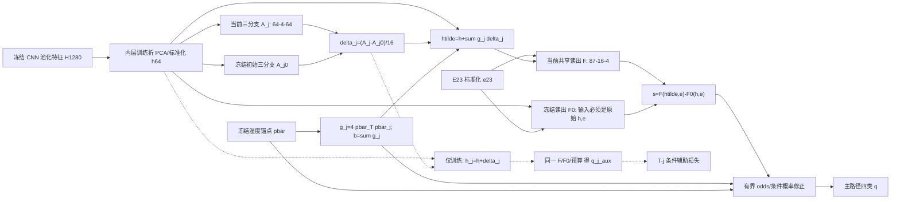

# 恒等中心化有界角色适配网络规格

## Material Passport

- 日期：2026-10-12，按用户客户端日期；候选版本：`IC-RFA-B v1`。
- 用户授权原文：**同意先写新网络规格**。授权仅覆盖规格编写，不覆盖实施计划、代码、合成运行、真实训练、stop 评价或正式报告修改。
- 状态：`DRAFT_FOR_WRITTEN_SPEC_REVIEW`。新网络尚未实现或训练，本文尚待用户书面审核。
- 工作流：brainstorming / architectural；academic-research-suite / experiment-agent plan。
- 证据基线提交：`d34d853a0b2f6352f6b975cede91e68560057f83`。
- Verification Status：`UNVERIFIED`。以下为设计及作者侧解析推导，不是独立数学审稿或已通过的实验结果。
- 目标：为技术报告和第一篇论文形成**经强对照验证的网络方法贡献**；不以增加公式或更换模型名称替代新颖性与效果。

## 1. 研究范围与问题

保留 B 主线：公开标本图像上的钒钛矿相关成分矿物四类角色视觉代理任务。类别顺序固定为 T、Ti、G、M，对应 `target_mineral`、`ti_bearing_negative`、`gangue_negative`、`metallic_hard_negative`。阶段条件化 C、真实工艺动作、送检成本、品位预测与工业回收率均不进入本规格。

研究问题分三层：

1. 能否在初始预测严格回到锚点的同时，避免串联零初始化结构性关闭适配分支的参数 Jacobian？
2. 该修复是否仍满足既有特征/概率扰动限制，且实际学习路径不是长期无效分支？
3. 在普通路由获得相同修复、监督、参数和优化机会后，角色路由是否还有额外目标纠错作用？

第一层是实现与机制问题，第二层是结构分析，第三层才是网络方法贡献的关键。前两层通过不等于原创性或识别性能通过。正式报告继续保持唯一正式版本，不把本设计草案当作已完成成果。

## 2. 依据、取舍与不可回避的负结果

依据为 [LC-RFA 完整重跑记录](../../experiment_records/2026-10-12_lc_role_v2_results.md) 和 [梯度机制诊断](../../experiment_records/2026-10-12_lc_role_gradient_mechanism_diagnosis.md)。旧实验的注册筛选失败；R1/S1 三种子 stop argmax 完全相同，目标正确数为 40/41/40，低于锚点的 43。旧结果不被新规格覆盖或重新筛选。

372 条已有神经轨迹的读出首层首步数据梯度为零，258 条含适配器轨迹的下投影前两步数据梯度为零；第五步数据梯度弱和下投影范数收缩已观察到。它们支持检查结构，但不是整个性能负结果的唯一原因证明。

| 备选路径 | 取舍 |
| --- | --- |
| 只改正则化中心 | 成本低、便于机制对照，但不能消除零读出/零上投影的初始阻断，且不是新算法 |
| 固定函数参照中心化 + 有界适配，正则化中心独立消融 | **采用的候选**；初始恒等与参数非零可以分开，必须承担参照容量和计算成本，并与同修复普通路由比较 |
| 解冻骨干或增加新图像/工艺任务 | 本轮不采用；需要不同的数据、训练授权和研究设计，不能作为当前失败后的自动扩展 |

本规格不自动引入注意力、PCGrad、对比学习、伪标签、可学习预算或梯度直通估计。原型位于冻结 CNN 池化特征之后，不声称改造了 EfficientNet-B0 的 MBConv 或完成了端到端骨干创新。

## 3. 输入和冻结身份

拟议首轮机制探查仅使用已有 340 个 fit 分组（T=66、Ti=130、G=97、M=47），不读取原图、不提取新骨干特征、不打开其他分组，也不读 stop 数据或预测表。

| 输入/来源 | 合同 |
| --- | --- |
| 原始 fit 包 | `outputs/training/lc_role_adaptation_v2/development_fold_0/fit_raw.pt`，仅 fit；SHA-256 `d1edbe1f87977ce0a91639bc8cb455708d4c2e17d53340c48d11d2e8b2a568b1` |
| 分组分配 | 同目录 `inner_assignment.json`；SHA-256 `e603ba0b603bc903f82649dd19edaebb69f7e171be0dec2092d69048c5469927`；三个既有内层折，不重新随机划分 |
| raw 字段 | `p` 四类后验、`H` 冻结 1280 维视觉特征、`evidence` E18、`contradiction` 一列、`labels`、`records` |
| prepared 字段 | 每内层训练折拟合 PCA64、PCA 列标准化、E23 标准化、正全局温度 T0，得到 h64、e23、log-anchor |
| 数据身份 | `image_id`、`split_group_id` 和行顺序精确对齐，分组不跨训练/内层验证；缺类或不合身份即失败 |

E23 为 E18、四列 log(p) 和一列矛盾量的组合；不得宣称新增物理或元素信息。预处理仅依赖相应内层训练折，使用现有 full-SVD、载荷符号规范、标准差下限 1e-8，不 whitening。全 fit 上拟合的预处理或已训练最终网络不得作为所有内层折的起点，防止向内层验证带入标签信息。

冻结专家不在内层折重训；OOF 只表示既定专家特征条件下适配模块的内层结果，不是整个图像系统的独立交叉验证。

可复用既有内层预处理的前提是独立核对其训练行身份、代码、输入和状态哈希。不能仅凭目录名认定可复用。机制探查最多需要三个内层温度拟合，无全 fit 最终模型拟合。

记温度锚点为 $\bar p=\operatorname{softmax}(\log p/T_0)$，$t=\bar p_T$，$w_j=\bar p_j/(1-t)$。锚点、输入和预处理在训练网络时冻结；推理不输入标签、错分记录或验证集统计。

## 4. 明确网络结构

### 4.1 有界函数参照分支

定义当前分支 $A_j$ 和冻结初始参照 $A_{j,0}$：

$$
A_j(h)=\tanh\left(U_j\operatorname{SiLU}(V_jh+d_j)\right),
\qquad j\in\{\mathrm{Ti},\mathrm G,\mathrm M\}.
\tag{1}
$$

$$
\delta_j(h)=\frac{\varepsilon_f}{2\sqrt{64}}
\left[A_j(h)-A_{j,0}(h)\right],\qquad\varepsilon_f=1.
\tag{2}
$$

三个当前分支各为 `Linear(64,4,bias=True) -> SiLU -> Linear(4,64,bias=False) -> Tanh`，每支 516 个可训练参数。参照是初始化后的精确深复制，不训练、不更新、不共享可写存储。外层差值而不是内部线性差值定义式 (2)；系数为 $1/(2\sqrt{64})=1/16$，不能遗漏 2。

### 4.2 角色路由和普通路由

$$
g_j=4\bar p_T\bar p_j=bw_j,\qquad b=\sum_jg_j=4t(1-t),
\qquad \widetilde h=h+\sum_jg_j\delta_j(h).
\tag{3}
$$

主候选使用该角色路由。最重要的普通路由对照只将 $g_j$ 换成 $b/3$，其余结构、参照、初始化、损失和预算保持相同。

这些系数是后验竞争启发式，不是矿物真值概率、工业错误代价或物料流量。它们会抑制高置信错误的纠正；不增加最小门值、不改变已知后验来追求正结果。

### 4.3 正确的共享读出参照

$$
F_\theta(z,e)=W_2\operatorname{SiLU}(W_1[z;e]+c_1)+c_2,
\qquad s=F_\theta(\widetilde h,e)-F_{\theta_0}(h,e).
\tag{4}
$$

当前和参照读出尺寸均为 `87 -> 16 -> 4`。参照读出使用**原始冻结 h**，绝不能使用 $\widetilde h$；固定参照不依赖任何可训练适配参数。参照读出只在当前种子/训练折初始化时复制，不在每一步更新为当前网络。

主输出和三个辅助视图共享同一当前读出、同一参照读出。辅助视图为

$$
h_j=h+\delta_j(h),\qquad
s^{(j)}=F_\theta(h_j,e)-F_{\theta_0}(h,e).
\tag{5}
$$

辅助路径不乘 $g_j$，只用于训练和机制审计，不形成另外三个可选推理头。

冻结参照允许在已批准范围内对固定输入预先缓存函数值，但缓存必须绑定输入/种子/权重/预处理哈希。原始 h、e 在本研究中本来就没有可训练依赖，因此冻结参照值没有遗漏真实参数链式导数。不得在适配后输入上计算参照再 `detach()`，以人工梯度掩盖错误函数。

### 4.4 概率输出和数值合同

$$
\alpha=\bar\alpha b,\quad \beta=\bar\beta b,\quad
u=\alpha\tanh(s_T),\quad v_j=\frac\beta2\tanh(s_j),
\tag{6}
$$

$$
q_T=\sigma(\operatorname{logit}t+u),\qquad
q_j=(1-q_T)\frac{w_je^{v_j}}{\sum_kw_ke^{v_k}}.
\tag{7}
$$

式 (6)、(7) 同样作用于各辅助分数 $s^{(j)}$，锚点和预算始终来自原始输入，不用辅助预测重新计算。

CPU float64；以 logsumexp、logsigmoid、log-softmax 保持数值稳定。路由以 $4\exp(\log\bar p_T+\log\bar p_j)$ 计算，b 由求和获得。非法概率、非有限输入/输出或概率下溢触发失败，不静默裁剪；批量大小不应改变逐图数学输出。无 BatchNorm、Dropout、随机推理、邻居检索或额外温度后处理。

四类判定为主 q 的 argmax，完全相同分数时按固定类别顺序取第一个；不另调二分类阈值。

### 4.5 设计态结构草图

该图只描述设计，不是已实现模型或实测论文图。箭头表示函数输入，辅助模块实际还接收 e、原始锚点和原始 h 的参照值，与式 (5)--(7) 一致。后续实现通过后再制作 SVG/PDF 结构图，不用设计图冒充实施证据。

## 5. 初始化、参数量与公平成本

### 5.1 确定初始化

种子固定 20261002、20261003、20261004；保持既有读出 seed+100、各分支 seed+200+j 的独立随机流（j=0,1,2）。同种子不同正则化/路由控制的对应参数和参照必须逐元素一致。

各线性矩阵、首层/下投影偏置使用 fan-in 均匀分布，初始读出末层偏置 $c_2=0$。**U 和 W2 不再强制归零**。分布是规格要求，不允许因最新库默认值变化而悄悄改变；实施时锁定本地 PyTorch 版本并验证状态身份。[Linear 官方约定](https://docs.pytorch.org/docs/2.14/generated/torch.nn.Linear.html)仅支持分布依据，不是本地已升级到该版本的证据。

| 参数 | 初始范围 |
| --- | --- |
| V_j，d_j | uniform(-1/8, 1/8) |
| U_j（无偏置） | uniform(-1/2, 1/2) |
| W1，c1 | uniform(-1/sqrt(87), 1/sqrt(87)) |
| W2 | uniform(-1/4, 1/4) |
| c2 | 零 |

每个独立随机流只构造一次：分支按 V/d、U 顺序，读出按 W1/c1、W2/c2 顺序，使用锁定版本的 `Linear` 初始化，再把 c2 明确置零并深复制参照。不另行重初始化或多消耗随机数；记录版本、构造顺序和完整初始化哈希。若锁定版本的默认分布不符合上表，必须先修订规格，不能在实现中临时换初始化方式。

### 5.2 参数与参照储存

三个分支共 1548 个可训练参数，共享读出 1476 个，共 **3024 个可训练参数**。中心化网络另有 **3024 个固定函数参照参数**，合计 6048 个模型标量，不含骨干和预处理。SP 正则化直接复用这些同身份初始参照，不能另复制一套后忽略内存成本。

原始零参数化控制只有 3024 个可训练参数；其 SP 控制在训练期还需初始参数快照，而非第二个前向函数。不能给它加无用填充参数来伪造相同总容量。主角色/普通路由对照在中心化参数化下均为 3024+3024，计算路径和缓存机会相同。

动态推理需三个当前分支、三个固定参照分支、当前读出和固定参照读出；固定数据缓存可减少重复计算，但必须另报缓存构建、储存和无缓存成本。不能只凭相同可训练参数数称“相同表达能力/计算量”。

## 6. 损失与独立正则化因子

令 $I_j=\{i:y_i\in\{T,j\}\}$，

$$
L_{\rm pair}=\frac13\sum_j\frac1{|I_j|}\sum_{i\in I_j}
\operatorname{BCE}\left(\mathbf1_{y_i=T},
\frac{q_{i,T}^{(j)}}{q_{i,T}^{(j)}+q_{i,j}^{(j)}}\right).
\tag{8}
$$

$$
L_{\rm data}=\frac1n\sum_i[-\log q_{i,y_i}]+.10 L_{\rm pair},
\quad L_O=L_{\rm data}+\frac\lambda2\|\theta\|^2,
\quad L_S=L_{\rm data}+\frac\lambda2\|\theta-\theta_0\|^2.
\tag{9}
$$

θ 为所有当前可训练权重与偏置，固定参照/骨干/预处理不进入优化器。完整候选使用 $L_S$；$L_O$ 必须作为独立对照。随机初始参照并不具有 L2-SP 文献中源任务预训练知识，不能直接搬用其泛化解释。

主任务不加类别权重；三类辅助权重均为 1/3，不制造工业代价。全批次保证每对有样本，缺类即失败。SP 使初始正则化梯度为零，**不保证数据梯度非零或后续收敛**。不同时修改学习率、损失权重和路由后将收益归因于某一项。

## 7. 理论命题及必须保留的条件

### P1：恒等起点不要求零函数 Jacobian

当前参数等于固定初始参照时，式 (2) 给出 $\delta_j=0$，式 (4) 给出 $s=0$，所以 $q=\bar p$。这是函数值恒等。

令 $\bar V_j=[V_j,d_j]$，$\bar h=[h;1]$，$a_{j,0}=\operatorname{SiLU}(\bar V_{j,0}\bar h)$，$z_{j,0}=U_{j,0}a_{j,0}$。对方向扰动有

$$
D_{U_j}\delta_j[\Delta U]=\frac{\varepsilon_f}{2\sqrt{64}}
\operatorname{diag}(\operatorname{sech}^2 z_{j,0})\Delta U a_{j,0},
\tag{10}
$$

$$
D_{\bar V_j}\delta_j[\Delta\bar V]=\frac{\varepsilon_f}{2\sqrt{64}}
\operatorname{diag}(\operatorname{sech}^2 z_{j,0})U_{j,0}
\operatorname{diag}(\phi'(\bar V_{j,0}\bar h))\Delta\bar V\bar h.
\tag{11}
$$

固定参照不依赖当前参数，所以这些参数微分不被参照项减掉。但 a=0、导数退化、后续矩阵乘积抵消或极小预算仍可使有效梯度为零/很小；不得声称随机非零初始化无条件产生非零损失梯度。

错误构造 $F_\theta(\widetilde h,e)-F_{\theta_0}(\widetilde h,e)$ 在初始点的真实输入 Jacobian 相消。若把后一项 `detach()`，自动求导会产生与该值函数真实有限差分不一致的人工梯度；本规格不允许这种直通修补。正确式 (4) 的参照输入独立于适配参数，真实导数与自动求导应一致。

### P2：双预算稳定证书继续成立

式 (2) 每坐标差值绝对值不超过 2，故

$$
\|\delta_j\|_2\leq\varepsilon_f,\quad
\|\widetilde h-h\|_2\leq\varepsilon_f b,\quad
|u|\leq\bar\alpha b,\quad\operatorname{span}(v)\leq\bar\beta b.
\tag{12}
$$

令 $q^{\rm off}$ 是**同权重、同固定参照**但关闭特征适配的主输出；其分数为 $F_\theta(h,e)-F_{\theta_0}(h,e)$，训练后不一定等于锚点。若当前读出对视觉输入的 Lipschitz 上界取

$$
L_F=(1+e^{-1})\|W_2\|_2\|W_{1,h}\|_2,
\quad\eta(x)=(\bar\alpha+\bar\beta)\varepsilon_fL_F b(x)^2,
\tag{13}
$$

则

$$
|\log q_y-\log q_y^{\rm off}|\leq\eta(x).
\tag{14}
$$

证明：主路径特征差不超过 ε_f b；固定参照在两路径中相同而消去；tanh 的 1-Lipschitz 性与输出预算再产生一个 b，随后用 log-softmax 差值界。另对 T/j 的 log-odds，用 $\log(q_T/q_j)=\operatorname{logit}t+u-\log w_j-v_j+\log\sum_kw_ke^{v_k}$，其变化不超过 η；非目标类 j/k 的 log-odds 变化不超过 $\bar\beta\varepsilon_fL_Fb^2\leq\eta$。因此 q_off 唯一获胜类的全部 log-margin 大于 η 时，同权重特征适配不能改变它；这一 margin 条件依赖上述成对界，不能仅从式 (14) 的两个单类界推出。这不保证获胜类正确，也不能将 q_off 等同于另训普通路由或 T0。

无缩放辅助 h_j 只得到把 b² 换成 b 的对应证书。新非零读出可能带来更大的 L_F 和更松证书；须报告实际谱范数、界大小及保护覆盖率，不能把相同公式当更好的实用保护。

输出层的有限纠错包络、NLL 漂移及模型间 KL 上界仍按 [既有推导](../../experiment_records/2026-10-05_bounded_role_residual_theory.md)逐样本核验；它们属于所有同约束模型，不归角色路由独占。本规格不放宽预算包络、不保证目标召回提升。

### P3：起点处有效 Jacobian 与路由核关系

对 $\ell_j=\log q_T-\log q_j$，令

$$
a_j=\left(\bar\alpha,\frac{\bar\beta}{2}(w-e_j)\right)^\top,
\quad J_hF_0=W_{2,0}\operatorname{diag}(\phi'(\cdot))W_{1,h,0}.
\tag{15}
$$

e_j 在式 (15) 是三维类别基向量，不是 E23 输入。在共同零适配起点，

这里 $J_hF_0$ 是当前读出对适配视觉坐标 z 的偏导，不是整个模型对原始 h（连同参照、路由）的总导数。

$$
J_{\vartheta_j}^{\rm aux}=b\,a_j^\top J_hF_0D_{\vartheta_j}\delta_j,
\qquad J_{\vartheta_j}^{\rm main}=g_jJ_{\vartheta_j}^{\rm aux}.
\tag{16}
$$

因此在 b>0 时，有效辅助 Jacobian 非零的准确条件是右侧矩阵乘积非零；主路径还需要 g_j>0。这是结构性条件，不是损失梯度下界。原始零读出使 $J_hF_0=0$，中心化只能去掉这项必然阻断，不会保证剩余乘积非零。

对 n 个固定输入的该**标量分支块**，

$$
K_j^{\rm main}=G_jK_j^{\rm aux}G_j,
\qquad G_j=\operatorname{diag}(g_j(x_1),\ldots,g_j(x_n)).
\tag{17}
$$

所有 g_j 严格正时两块秩相同；若还已知辅助块正定且 g_min>0，则 $\lambda_{\min}(K_j^{\rm main})\geq g_{\min}^2\lambda_{\min}(K_j^{\rm aux})$。缺少这些条件不能声称可学习性保证。该恒等仅适用于共同零适配起点，不适用于全部训练过程、全部参数联合核或任意 NLL Hessian。

固定路由改变方向权重与尺度，并不自动增加秩；更大的核迹或梯度也不保证更好的目标纠错。核分析是解释与约束论证，不是新的普适 NTK 定理或网络效果证明。

## 8. 强对照矩阵：不能只有新模型对旧弱模型

三个因子为：**Z/C 参数化整块**（原始串联零起点/式 (1)--(7) 中心化非零参照）、**O/S 正则化中心**、**U/R 路由**（均匀/角色）。Z/C 包含参照函数和差值缩放的改变，不是“只换初始化”的单变量干预；不得将该对比独占解释为初始化效果。

所有八个核心单元均训练 3024 参数，使用相同辅助视图损失、输入、预算、学习率、种子和内层划分。

| 单元 | 参数化 | 正则化 | 路由 | 研究作用 |
| --- | --- | --- | --- | --- |
| Z-O-U | 原零结构 | 零中心 | b/3 | 原普通路由条件的机制基准 |
| Z-O-R | 原零结构 | 零中心 | bw_j | 原角色条件的机制基准 |
| Z-S-U | 原零结构 | 起点中心 | b/3 | 仅改正则化中心的普通控制 |
| Z-S-R | 原零结构 | 起点中心 | bw_j | 仅改正则化中心的角色控制 |
| C-O-U | 中心化 | 零中心 | b/3 | 中心化但保留旧正则化 |
| C-O-R | 中心化 | 零中心 | bw_j | 与前一行分离角色路由 |
| C-S-U | 中心化 | 起点中心 | b/3 | **最重要的同修复强对照** |
| C-S-R | 中心化 | 起点中心 | bw_j | 完整研究候选 |

Z 的下投影/首层随机初始化与 C 同种子对应层一致，Z 仅按旧规则把 U、W2 和末层偏置归零；Z-S 的正则参照是该 Z 起点，而不是 C 起点。旧脚本与协议不直接修改；未来新模块独立表达这些控制。

必需的四个附加单元为：

| 单元 | 设置 | 作用 |
| --- | --- | --- |
| HC-S | 无适配器，中心化 87-16-4 共享读出，SP，NLL+.1 主输出 pair loss | 排除普通读出与辅助监督作用；1476 当前+1476 函数参照参数 |
| FC-S | 同上，读出 87-34-4 | 普通更宽非线性强对照；3132 当前+3132 函数参照参数，并非精确同容量 |
| C-S-U-noaux | C-S-U，pair 权重为 0 | 去掉辅助监督的普通控制 |
| C-S-R-noaux | C-S-R，pair 权重为 0 | 去掉辅助监督的角色控制 |

HC/FC 没有三适配视图，其 pair loss 在主输出上计算；这种差异要保留，不能伪称与完整网络监督路径完全相同。主机制结论优先依赖 C-S-R/C-S-U，而不是完整网络与较小头的比较。

T0 作为每个内层训练折的温度锚点基准。P/E 凸对照与无界 U 类对照留给未来完整效果协议，不混入此处的有限机制探查，也不能因本轮未比较就声称全面胜出。

## 9. 合成验收规格

只有用户审核规格、实施计划并批准开发后才执行。需要覆盖：

| 验收项 | 必须证明的行为 |
| --- | --- |
| 身份 | 初始当前/参照值相等但无可写别名；C 单元初始主/辅概率等于锚点 |
| 参数 | 当前/函数参照/正则参照计数及真实存储明确；参照没有可训练梯度且优化后哈希不变 |
| 正确链式导数 | 预先构造非退化小样例，U/V/首层有效 Jacobian 非零；自动求导与中心有限差分一致 |
| 串联因素 | 在同一中心化结构中分别把 U 或 W2 置零，核对各自的阻断条件；不能靠筛选随机种子验证 |
| 错误参照反例 | 固定读出参数，仅改变适配参数；两项都使用适配后输入时适配器输入链式梯度相消。若第二项 detach，有限差分应识别伪梯度，不把它当通过方案；读出参数本身的梯度不要求相消 |
| 全路径界 | 分支范数、主特征扰动、u/v 幅度、主/辅相应证书和原输出包络逐行核对 |
| 起点核关系 | 式 (16)、(17) 在标量分支块成立；包括重复输入导致奇异的反例，不能只测正定例子 |
| 方向重排 | 同时重排分支、路由和辅助角色索引，输出/损失等价；单独错配只作为错误检测 |
| 等价读取 | 初始/训练后同权重关闭适配的输出、同修复 U/R 对照、变批量/缓存/保存重载一致 |
| 边界失败 | 非法概率、缺类、错身份、下溢、非有限数、参照哈希变化、时间或监督中断均失败，不自动重试 |

初始 log 概率/概率相等采用绝对容忍度 1e-12；一般界违规容忍度 $10^{-10}+10^{-10}|\mathrm{bound}|$。有限差分使用预定方向和步长 1e-6，比对阈值 $10^{-7}+10^{-5}|\mathrm{derivative}|$；不得事后换步长消除错误。构造非退化样例的 Jacobian 范数下限为 1e-8；该测试下限不适用于任意真实样本。

保存全部最大误差和失败样例。合成通过只说明实施与规格一致，不支持矿物识别收益。

## 10. 拟议 fit-only 机制探查

本节是下一阶段协议的设计边界，**不构成当前执行授权**。

- 仅现有 fit_raw 和既有三个内层分组，严格不准备或评价 stop。340 个分组只用于探索，不是独立确认数据。
- 12 个神经单元 × 3 内层折 × 3 种子，最多 **108 条轨迹**；预处理相同，最多另做 3 次温度拟合。无全 fit 最终重训，无新网格，无自动扩轮次。
- 固定 λ=.001、alpha_max=beta_max=.5、ε_f=1、瓶颈4、辅助权重.1（noaux 为0），Adam lr=.001、betas=(.9,.999)、eps=1e-8、weight_decay=0，CPU float64、全批次。
- 每条最多400更新，全部保留 0/1/2/5/20/50/100/200/400 检查点；不根据内层验证挑选最佳参数或轮次。100步是预先指定的主要描述性比较点，其他点用于轨迹解释，不能见到结果后换主点。
- 拟议累计硬上限7200秒，涵盖准备、训练、梯度/Jacobian/核诊断和导出。实施计划应以合成计时估计负载；此上限不是预计耗时或现有已获准的6小时预算复用。
- 所有首次数据暴露、状态哈希、实际拟合数、时间、超时/失败均记录。失败即保留证据并停止，不能自动重试、读新图片、改模型或追加新的控制寻找正结果。

后续实现必须保存前五次更新前的**完整数据/正则化/总梯度向量**，以及各检查点梯度范数、参数与参照距离、分支输出范数/相似度、固定状态逐分支移除的输出变化。梯度来源明确，不用范数相减伪造正则化向量，也不把参数梯度范数等同于 Adam 坐标更新贡献。

初始标量 Jacobian/Gram 使用内层训练行，记录输入顺序、路由、矩阵、奇异值与绝对有效秩阈值1e-10；不同参数化尺度下该数值秩仅是诊断。训练后只记录实际 Jacobian，不能仍断言式 (17) 精确成立。真实零梯度或奇异核应保留，不触发换种子/扰动输入。

在100步汇总每种子的三折 pooled OOF NLL、目标正确数及原始分母、Ti/M 假目标数、完整混淆矩阵、Macro F1、Brier、固定15桶ECE与逐图新增/错改。三种子是算法重复，分组重叠的三个内层训练折也不是独立样本；不做无依据的显著性检验。

400步终止不等于收敛，驻点不等于全局最优。普通对照存在优化疑问时，不能据其较差 NLL 声称独立角色优势。分析先说明探索范围与固定更新预算，是否足够进入完整效果阶段由另一次书面审核决定。

## 11. 可证伪判断与进入完整研究的门槛

| 观察 | 允许的结论 | 不允许的结论 |
| --- | --- | --- |
| C 的有效初始 Jacobian 在非退化验收中非零 | 避免特定结构性阻断 | 任意真实样本梯度有正下界 |
| S 减少早期纯正则化收缩 | 正则化中心影响轨迹 | 正则化理论创新或必然提高召回 |
| C-S-U 与 C-S-R 均优于 Z，但彼此近似相同 | 中心化/正则化修复可能有用 | 角色路由创新有效 |
| C-S-R 仅降低NLL，却损失正确目标 | 概率质量与目标纠错有权衡 | 更好的选矿预选效果 |
| 界全部满足但分支仍无实际作用 | 结构实施符合限制 | 新网络有效或有实用保护 |
| 梯度更大/核迹更大但OOF无改善 | 初始学习尺度变了 | 核越大性能越好 |

提出下一份完整效果实验协议前，必须同时说明：C-S-R 对同修复 C-S-U 的方向一致增量、对普通宽头的比较、目标新增与损失、两类误入、分支真实作用、未收敛风险、参照成本和剩余查新差异。若没有方向一致的角色增量，不自动进入 stop 搜索或新数据确认。

即使 fit-only 机制有正结果，也不直接写入正式报告“创新已验证”。完整效果协议需要另行冻结选模、对照、所有预算、一次开发 stop 评价的目的和后续真正未暴露分组确认；不得直接复用已暴露 stop 当独立测试。此阶段不在本规格的授权或108条机制轨迹范围内。

## 12. 新颖性、交付和审核门槛

本候选使用的中心化、起点正则化、低秩/瓶颈适配、分支路由和辅助损失均有前例。明确引用：

- [Li 等，ICML 2018，L2-SP](https://proceedings.mlr.press/v80/li18a.html)：预训练起点正则化；不能照搬其性能或把随机起点说成源知识。
- [Chizat 等，NeurIPS 2019，第3.2节](https://proceedings.neurips.cc/paper_files/paper/2019/file/ae614c557843b1df326cb29c57225459-Paper.pdf)：中心化CNN输出并保留初始参数微分；不是本研究首次提出。
- [ReZero，UAI 2021](https://proceedings.mlr.press/v161/bachlechner21a.html)：恒等起点与后续学习，不能由初始零梯度推出性能必然差。
- [LoRA-GA，NeurIPS 2024](https://proceedings.neurips.cc/paper_files/paper/2024/hash/62c4718cc334f6a0a62fb81c4a2095a1-Abstract-Conference.html)、[Beyond Zero Initialization，ICML 2025](https://proceedings.mlr.press/v267/li25bm.html)：初始化与梯度动态已有研究。
- [R-LoRA，Findings EMNLP 2025](https://aclanthology.org/2025.findings-emnlp.35/)：多头随机化及初始函数抵消已有研究。
- [Jacot 等，NeurIPS 2018](https://proceedings.neurips.cc/paper_files/paper/2018/hash/5a4be1fa34e62bb8a6ec6b91d2462f5a-Abstract.html)：参数Jacobian核理论；不在本小网络上套用无限宽收敛结论。

候选贡献应表述为：**拟针对矿物角色混淆，在固定后验锚点约束下研究可学习的角色特征修正，联合分析恒等起点、扰动保护与路由学习尺度，并通过同修复普通结构检验增量目标纠错。** 这是领域方法贡献候选，不是已实现纯数学理论突破。所有本文推导都需实现核验和后续独立检查；严禁“首次”“保证召回提升”“工业分选已实现”等提前声明。

本轮交付仅此书面规格与 README 导航，未创建新网络代码、测试代码、训练协议、实验结果或第二份正式报告。正式报告 SHA-256 保持 `b7319ccf6def029f5bbc9ae61a0a68ff867c2751433b4876d8f68f7a2ac82d0c`。既有旧版代码、v1失败目录、v2负结果及诊断原始证据全部保留。

用户审核本文后才编写实施计划；实施计划仍需单独审核并选择执行方式。之后才申请代码/合成验收，真实fit-only机制探查又需独立登记与批准。本文的数值范围是供审核的设计，不是执行许可证；既有392次拟合授权不被继承。

审核重点：式(2)的1/16缩放、固定参照的原始输入、正确导数与detach禁用、3024当前+3024参照成本、Z/C因子的真实含义、C-S-U强对照、12单元fit-only范围、理论命题限制。研究资料采用AI辅助梳理与作者自审，没有独立第三方审核或新实验效果。
