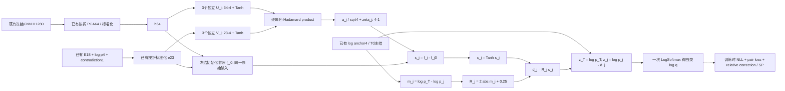

# MSB-RRE v1：间隔缩放预算的角色残差证据网络

## Material Passport

- 日期：2026-10-14。
- 状态：`DRAFT_FOR_HUMAN_REVIEW`，书面机制规格，不是实施计划或运行协议。
- 编写授权：用户在 `call_b71499819f6c4a8f9f7d2c966238fe40` 选择“批准机制筛选、查新与规格编写（推荐）”。这没有批准本规格的方法细节或真实实验。
- 来源：[限域查新/机制筛选](../../experiment_records/2026-10-14_margin_scaled_role_mechanism_screening.md)、[既有离线审计](../../experiment_records/2026-10-14_ic_role_offline_theory_audit.md)；起点提交 `7d58b29507231cfa6c6de175134c4625b78dbfec`。
- 本轮只读源码、文字证据和公开文献，不读取真实张量/原图，不执行前向、自动微分、拟合或训练，不开发模型，不改正式报告。
- 数学为作者/AI辅助推导与自审，未做独立理论复核、数值验收或新效果实验。

## 1. 研究问题、贡献边界与替代方案

研究问题：**在冻结矿物视觉表征及现有四类角色标签下，能否用可观测的角色证据直接修正判别间隔，在不预先冻结高置信错误的条件下，提高目标代理类净纠错并控制Ti/M干扰误入？**

这是B主线的候选后端网络模块，不是改造EfficientNet-B0的MBConv，不是端到端CNN新骨干，也不是元素品位/工业回收率预测。C阶段条件化动作仍只作后续方向。旧基线、Focal Loss和IC-RFA负结果不得替换或隐藏。

| 替代方案 | 本次选择 |
|---|---|
| 旧置信预算加常数下限并继续共享适配 | 不作为主候选；不能证明容量足够或角色贡献独立。 |
| 无界普通/角色残差 | 保留强对照；其输出能力很强，不能以原旧预算作为唯一弱对照。 |
| 间隔缩放半径＋角色非线性交互 | 作为本规格候选；通过有限内部见证、边界控制导数和强对照验证来证伪。 |

候选贡献必须分拆：**预算参数化性质**、**角色证据学习效果**、**数据与泛化证据**。前一项成立不推出后两项；双线性融合、辅助二分类、固定参照和softmax残差都已有先例，不单列为原创。

## 2. 输入、身份与数据隔离

类序保持 `0=T/target_mineral`、`1=Ti/ti_bearing_negative`、`2=G/gangue`、`3=M/metallic_hard_negative`。

只设计复用既有340个fit分组及其三个内层划分，计数66/130/97/47来自已归档审计；本轮不重读输入。后续若获准机制实验，拟复用**已有按折prepared状态**，不重拟合PCA/T0，不读取 `projector_stop` 或原图。

| 推理输入 | 含义及约束 |
|---|---|
| $h\in\mathbb R^{64}$ | 既有冻结CNN池化H1280，经对应内层训练折PCA64/标准化；不新增特征提取。 |
| $e\in\mathbb R^{23}$ | E18、四列log(p)、一列矛盾量的既有标准化输入；不是新物理传感器或元素信息。 |
| $\log\bar p\in\mathbb R^4$ | 对应内层温度锚点的归一化log概率，严格正概率、有限值；不得用当前修正输出反馈更新。 |
| 分组/标签 | 仅后续训练与评价使用；推理计算不访问真实类别、矿区未来标签或oracle见证。 |

所有三个输入对当前参数冻结。已有专家可能并非全管线独立折训练，故机制结果只能叫“条件于冻结专家的fit内分组验证”；不能改名为独立测试。新的未暴露确认集须另行核验及批准，当前不保证其数量/可用性。

## 3. 角色证据分支：完整公式与尺寸

对角色 $j\in\{1,2,3\}$，设置独立的低秩视觉/证据交互分支，秩固定 $r=4$：

$$
f_{\theta_j}(h,e)=\frac{1}{\sqrt r}\,a_j^\top
\left[\tanh(U_jh+u_j)\odot\tanh(V_je+v_j)\right]+\zeta_j.
\tag{1}
$$

尺寸：$U_j:4\times64$，$u_j:4$，$V_j:4\times23$，$v_j:4$，$a_j:4$，$\zeta_j:1$。分支不共享可训练参数，不再产生64维特征残差，也不经过另一个可训练共享87→16→4读出。

初始化时精确复制固定函数参照 $f_{\theta_{j,0}}$，定义

$$
s_j=f_{\theta_j}(h,e)-f_{\theta_{j,0}}(h,e),\qquad
c_j=\tanh s_j.
\tag{2}
$$

参照使用同一原始冻结 $h,e$，不随当前模型更新，不共享可写存储；没有对当前函数的detach伪梯度。恒等起点 $s_j=c_j=0$，但当前函数参数微分不被固定参照消去。分支内部矩阵梯度仍可能因输入/乘积退化为零，不能保证所有参数块同时非零。

Hadamard低秩融合是[既有方法](https://arxiv.org/abs/1610.04325)。这里不宣称首次融合，也不把同一图像的视觉特征和专家证据叫成新增物理多模态。

## 4. 间隔缩放预算与唯一概率输出

冻结anchor的成对间隔和半径为

$$
m_j=\log\bar p_T-\log\bar p_j,\qquad
R_j=\gamma|m_j|+\tau,\qquad
\gamma=2,\quad\tau=0.25.
\tag{3}
$$

$\tau$单位是log-odds。常数是本次事前设计选择，不由任何新真实数据挑选；规格审核前不作为已冻结实验超参。预算不是学习头，也不乘 $4\bar p_T(1-\bar p_T)$，因此不会仅因错误anchor很自信就归零。

$$
d_j=R_jc_j,\qquad
z_T=\log\bar p_T,\quad z_j=\log\bar p_j-d_j,\qquad
\log q=z-\operatorname{LSE}(z)\mathbf1.
\tag{4}
$$

这里只有一次共同归一化，三个pair概率不单独拼接。恒有

$$
M_j:=\log(q_T/q_j)=m_j+d_j,
\quad \log(q_j/q_k)=m_k-m_j-d_j+d_k.
\tag{5}
$$

式(4)仍是普通后验softmax残差的一种受约束参数化。不能把根式图/三个边头本身说成扩大无约束四类输出自由度；本规格的待验证作用是半径与证据学习。

### 公式化结构图，尚未实施

图中CNN/PCA/T0均冻结；虚线仅训练损失，真实标签不是推理输入。该图不能用作“已运行新网络”的实验图证据。

## 5. 参数、初始化和计算范围

每分支参数数目

$$
4\cdot64+4+4\cdot23+4+4+1=361,
$$

共1083可训练参数及1083固定参照标量。SP直接复用函数参照作为参数原点，不另复制未计数的快照。此数不包括冻结CNN、PCA/T0、优化器状态及缓存，不等同于全系统参数/FLOPs。

原型仍拟采用CPU float64及三个既有初始化种子20261002/20261003/20261004。角色$j$使用独立随机流 `seed+200+(j-1)`。按U、V、a的顺序抽样一次，分别均匀于 $[-1/\sqrt{64},1/\sqrt{64}]$、$[-1/\sqrt{23},1/\sqrt{23}]$、$[-1/\sqrt4,1/\sqrt4]$；u/v/zeta直接置零，不消耗额外随机数。CONCAT-MLP和LIN-UNB按其形状的fan-in抽样、bias置零，使用 `seed+100` 随机流后精确复制参照；SHARED-BIL使用第12节的匹配嵌入，而非另抽不对应参照。

所有同形消融复用完全相同初始化/参照字节，不只是写同一seed。不同宽度对照不声称参数一一对应。没有BN、Dropout、在线邻居、伪标签、直通估计或额外后处理温度。

## 6. 目标函数及公平的相对修正惩罚

训练真类 $y_i$；对集合 $I_j=\{i:y_i\in\{T,j\}\}$，成对标签 $a_{ij}=+1$代表T、$-1$代表j。定义

$$
L_{\rm pair}=\frac13\sum_{j=1}^3\frac1{|I_j|}
\sum_{i\in I_j}\operatorname{softplus}(-a_{ij}M_{ij}).
\tag{6}
$$

pair loss使用**主输出的相同log-odds**，不是另一套未约束辅助预测。标签没有新增，辅助损失改变监督权重而不是提供额外真值信息。

$$
L=-\frac1N\sum_i\log q_{i,y_i}
+0.1L_{\rm pair}
+\frac{0.01}{3N}\sum_{i,j}\left(\frac{d_{ij}}{R^{\rm ref}_{ij}}\right)^2
+\frac{0.001}{2}\sum_j\|\theta_j-\theta_{j,0}\|_2^2,
\tag{7}
$$

其中 $R^{\rm ref}=2|m|+0.25$ 固定为主模型的事前参考半径，**所有普通、固定半径和无界神经对照的惩罚均用这个相同参考量**。主模型时$d/R^{\rm ref}=c$。这样半径消融不同时偷偷改变实际修正惩罚的定义。主NLL不使用类别逆频率权重，与旧IC机制一致；不得将它与原CNN加权基线称为同一训练实验。

无辅助消融只将0.1换成0，其他项不变。初始化时函数修正和SP梯度均为零，不意味着数据梯度为零。优化器、步数、时间及所有预算由后续实施计划/真实预登记另行明确，不在此规格里授权。

## 7. 可证明性质一：全类别内部可达见证

**假设：** anchor严格正，$\gamma>1,\tau>0$，逐图输出坐标$c_j$可以在$(-1,1)$独立选择。不先假设共享网络能共同实现这些选择。

对目标类，取全部$c_j=1/\gamma$，则

$$
M_j=m_j+|m_j|+\tau/\gamma\ge\tau/\gamma>0.
\tag{8}
$$

对非目标真类y=j，取$c_j=-1/\gamma$，其他$c_k=1/\gamma$。于是

$$
\log(q_j/q_T)=-m_j+|m_j|+\tau/\gamma\ge\tau/\gamma,
$$

$$
\log(q_j/q_k)=m_k-m_j+|m_j|+|m_k|+2\tau/\gamma
\ge2\tau/\gamma\quad(k\ne j,T).
\tag{9}
$$

所有类别均可唯一胜出，且所需分数只有$s_j=\pm\operatorname{atanh}(1/\gamma)$，不随anchor间隔增大而趋向无穷；$|c_j|=0.5$位于本规格tanh的内部，而非端点。

此见证也能由具体网络实现：保持所有U/V/a及其bias等于固定参照，只将三个当前zeta置为上述正负常数，则$s_j=\zeta_j$，SP平方距离为$3\operatorname{atanh}(1/\gamma)^2$，与anchor大小无关。但同一符号模式会将**所有输入推向同一个指定类**，不是共同拟合不同标签的保证。这一反例要求第12节的bias-only强对照，不能把此性质当作视觉证据作用。

**不推出：** 340图能训练到全部正确、保证召回提升、有限参数联合可达、标签是真正矿物真值、或来源外泛化。公式中的y只选数学见证，不能进入部署计算。它只消除旧固定置信预算的逐图排除机制。

反例/失败条件：$\gamma\le1$不能一般保证固定内部见证；$\tau=0$时零anchor间隔不能得到上述严格正界；在式(3)外再乘趋零置信门控会破坏性质。实际数值溢出/下溢也不由实数定理解决。

## 8. 可证明性质二：成对边界的控制导数

固定输入，$M_j=m_j+R_j\tanh s_j$。在成对判别边界$M_j=0$处

$$
c_j^*=-m_j/R_j,\qquad |c_j^*|<1/\gamma,
$$

$$
\left.\frac{\partial M_j}{\partial s_j}\right|_{M_j=0}
=R_j(1-(m_j/R_j)^2)
\ge\tau(1-\gamma^{-2})>0.
\tag{10}
$$

因$\partial s_j/\partial\zeta_j=1$，同一下界也作用于当前分支的标量bias控制。对成对logistic损失，边界处

$$
\left|\frac{\partial\operatorname{softplus}(-a M_j)}{\partial\zeta_j}\right|
\ge\tfrac12\tau(1-\gamma^{-2}).
\tag{11}
$$

在恒等起点，若有效成对样本$a m_j\le0$，则

$$
\left|\frac{\partial\operatorname{softplus}(-a m_j)}{\partial\zeta_j}\right|
=R_j\sigma(-a m_j)\ge R_j/2\ge\tau/2.
\tag{12}
$$

这些是**单样本、未按批均值缩放的数据损失分量**。全批不同标签可抵消，其他损失/正则也可抵消；不保证全部参数块梯度、训练速度或非凸收敛。$q_T=q_j$也不一定是四类最终获胜边界，可能有第三类概率更高。

进一步，在内部见证$c_j=\pm1/\gamma$，对三个bias的逐输入归一化间隔Jacobian有

$$
\frac{\partial(M_j/R_j)}{\partial\zeta_k}
=\mathbf1\{j=k\}(1-c_j^2)
=(1-\gamma^{-2})I_{jk}.
\tag{13}
$$

这只是逐图3×3控制矩阵。它不等于多样本完整参数NTK；三个共享bias不能独立拟合任意多张图片，也不由此推出全样本Gram满秩。

## 9. 可证明性质三：角色修正功能量可识别

对于固定anchor，预测概率唯一决定

$$
d_j=\log(q_T/q_j)-\log(\bar p_T/\bar p_j).
\tag{14}
$$

对独立分支参数，若$k\ne j$，$\partial M_k/\partial\theta_j=0$；而$\partial M_j/\partial\theta_j=R_j(1-c_j^2)\partial f_{\theta_j}/\partial\theta_j$。没有当前共享读出去重新吸收角色输入变化。

识别对象是**输出函数量d**，不是双线性参数的唯一分解、因果效应或真实矿物特征。共同归一化下改变一条边仍会影响全部绝对概率，不能写成“只改变目标/j两类概率”。普通根式残差也可有式(14)，因此不是本网络独占创新。

后续消融必须记录$d_j$、各成对间隔、全类argmax、新增/损失正确与假目标；不能只报告非零特征/梯度或分支范数。

同状态关闭角色j直接置$d_j=0$，保留其他修正；关闭全部角色置全部d=0，严格返回anchor。这是架构规定，不是已测得的消融增益。它与旧IC-RFA关闭特征适配但保留已训练共享读出的$q^{off}$不同，不能混用归因基准；也不能把状态消融解释为重新训练的因果贡献。

## 10. 稳定性、惩罚代价与必须承认的代价

令$A=\max_jR_j$，$\Delta z=(0,-d_1,-d_2,-d_3)$。因$|d_j|<R_j$，

$$
|\log q_T-\log\bar p_T|\le A,\quad
|\log q_j-\log\bar p_j|\le R_j+A,
$$

$$
|\Delta\log(q_T/q_j)|\le R_j,\quad
|\Delta\log(q_j/q_k)|\le R_j+R_k.
\tag{15}
$$

证明：$\log\sum_k\bar p_ke^{\Delta z_k}$在$[-A,A]$内；分别代入log概率及其比值。此类softmax漂移是标准性质，[近期几何研究](https://arxiv.org/html/2610.17588v1)已有更一般分析，不作为首次理论。

内部纠错见证的平均相对能量恒为

$$
\frac13\sum_j(d_j/R_j)^2=1/\gamma^2.
\tag{16}
$$

所以本输出正则的oracle见证代价不会随错误anchor的$|m|$平方增长。第7节给出单一类常bias见证的有限SP代价，但一般随样本变化的见证函数没有由式(16)得到的SP/样本复杂度或泛化上界。

**关键取舍：** $A$随anchor间隔增长，不是输入无关的小常数保护。本方法有意允许高置信错误跨界，也允许损害高置信正确样本；不能同时宣称“保护一切高置信预测”和“任意高置信错误可纠正”。只有实际学习及强对照评价才能判断取舍是否值得。

## 11. 双线性交互的不等价范围

固定anchor，观察抽象输入$(h,e)$。若某点

$$
\nabla_h\nabla_e s_j\ne0,
\tag{17}
$$

则$s_j$不能表示为拼接输入上的单个仿射头，也不能表示为$g(h)+k(e)$。例如u=v=0、h=e=0时，当前函数的混合导数为

$$
\nabla_h\nabla_e f_{\theta_j}
=\frac1{\sqrt r}U_j^\top\operatorname{diag}(a_j)V_j;
$$

$s_j$是当前与固定参照的上述矩阵之差。这解释交互项与线性/可分加性头的区别，**不证明不能被普通非线性MLP或更宽共享双线性头表示**。真实e与p/图像相关，抽象自由输入域的区别也不保证实际数据具有新的独立信息。

必须有共享双线性强对照；不能把只胜过264参数线性头解释为角色关系创新。

## 12. 强对照与消融：拟议最小集合

所有神经对照使用同一$h,e,\log\bar p$、共同decoder、参考半径惩罚、主NLL及pair权重0.1，除表中明确变化。固定参照和SP同样保留。

| 单元 | 变化及目的 | 可训练参数 |
|---|---|---:|
| MAIN | 三个rank4角色交互分支＋$R=2|m|+.25$＋tanh | 1083 |
| SHARED-BIL | 共同rank12交互表示，完整12→3混合读出；同预算/损失，排除一般融合作用 | 1107 |
| CONCAT-MLP | 拼接87→12→3、Tanh、中心化；同预算/损失，普通非线性强对照 | 1095 |
| ADD | 同361参数分支，仅将投影后的Hadamard积换为逐元素和；显式乘性交互消融，外层tanh仍可能耦合输入 | 1083 |
| FIX1 | MAIN仅令实际输出半径$R^{out}=1$，参考惩罚仍用主$R^{ref}$ | 1083 |
| UNB-SCALE | MAIN仅去掉外层tanh，$d=R^{ref}s$；起点输出及数据梯度与MAIN匹配 | 1083 |
| NOAUX | MAIN仅pair权重为0；无新增标签/监督贡献核查 | 1083 |
| LIN-UNB | 87→3仿射中心化，$d=R^{ref}s$；相同pair/相对惩罚/SP，凸的普通强对照 | 264 |
| BIAS3-CVX | 相同间隔预算，仅三常数修正系数；具体网络的bias-only子模型，检查是否无需视觉分支 | 3 |
| CLASSWISE4 | 锚点＋3自由度类偏置；原始经典强基线，不使用额外特征 | 3 |
| REPAIR4-COMP | 下述论文启发的全部四类竞争特征对照 | 7 |

T0作为已有锚点参考，不另拟合。SHARED-BIL比MAIN多24参数、CONCAT-MLP多12参数，均**不是精确同容量**；它们有意给普通对照更强混合能力，须报告固定参照和计算量。SHARED-BIL参数为$12\cdot64+12+12\cdot23+12+3\cdot12+3=1107$；CONCAT-MLP为$87\cdot12+12+12\cdot3+3=1095$。

SHARED-BIL写为$F=A[\tanh(Uh+u)\odot\tanh(Ve+v)]/\sqrt4+\zeta$，$U:12\times64$、$V:12\times23$、$A:3\times12$。初始化U/V及其bias按MAIN三个rank4分支逐块堆叠；A的对应4列块置为各$a_j^\top$、其余24个混合权重置零但可训练，zeta置零，再复制固定参照。因已有对角块非零，不能把它等同于整个零读出。

该嵌入使共同参数/初始函数与MAIN匹配。保持其他块为零时，SHARED-BIL连同其固定参照可以精确表达MAIN；因此**不宣称MAIN表达能力严格大于普通共享网络**，要验证的是角色分离的学习偏置。ADD仅去除f层的乘积，不能称为去除完整预测函数的一切跨输入交互。

### BIAS3-CVX：不能遗漏的凸子模型

令三常数$c\in(-1,1)^3$，$d_{ij}=R^{ref}_{ij}c_j$，与MAIN使用相同decoder/NLL/pair。保持其他网络参数等于参照时，它对应$\zeta_j=\operatorname{atanh}c_j$；完整目标严格等价于

$$
L_B(c)=L_{NLL}(c)+.1L_{pair}(c)
+\frac{.01}{3}\sum_jc_j^2
+\frac{.001}{2}\sum_j\operatorname{atanh}(c_j)^2.
\tag{18}
$$

logits与pair margin对c仿射，前两项凸；且

$$
\frac{d^2}{dc^2}\operatorname{atanh}(c)^2
=\frac{2(1+2c\operatorname{atanh}c)}{(1-c^2)^2}\ge2.
\tag{19}
$$

因此$L_B$至少为$.001$强凸，端点惩罚趋无穷，存在唯一内部最优点。后续求解应保持内部可行、报告优化残差，不用未登记clipping改问题。可用$\|\nabla L_B\|^2/(2\cdot.001)$作强凸次优差上界；这是标准凸优化证书，不称原创。

在相同fit目标下，完整网络的最优值不会高于该可实现子模型的最优值。若MAIN的训练目标还高于充分求解的BIAS3-CVX，说明至少有可见优化欠缺，不能据此声称复杂角色视觉结构优越。即使MAIN训练目标更低也不保证验证集/未暴露集更好。

### REPAIR4-COMP的明确适配边界

参考[REPAIR v2 §5](https://arxiv.org/html/2604.01506v2)，固定$S=\{0,1,2,3\}$，用$g_y=\log\bar p_y$，竞争特征为score gap、rank gap、内层训练计数log-ratio和shortlist log-probability ratio。用同一4维theta对其他三个类平均，加三自由度类偏置$a$（令$a_T=0$），输出普通softmax；CE＋明确正ridge，拟议系数均.001。

为避免实施时改变符号，具体定义为

$$
\phi(x,y,k)=\left(g_y-g_k,\;\operatorname{rank}(k)-\operatorname{rank}(y),\;
\log n_y-\log n_k,\;\log P_S(y)-\log P_S(k)\right)^\top,
\quad P_S(y)=\frac{e^{g_y}}{\sum_{k\in S}e^{g_k}}.
\tag{20}
$$

$$
r_y=g_y+a_y+\frac13\sum_{k\ne y}\theta^\top\phi(x,y,k),\qquad
q^{\rm COMP}=\operatorname{softmax}(r).
\tag{21}
$$

这是引用方法的受限适配定义，不是我们的新理论。此处$S$为所有四类，所以$P_S=\bar p$；不用原文未实现的候选检索过程制造额外数据或自由度。

rank由冻结g降序确定，相同值按类别ID升序断开并列；n为对应内层训练组计数且每类为正。CLASSWISE4使用均值CE＋$.001\|a\|^2/2$，$a_T=0$；REPAIR4-COMP使用均值CE＋$.001(\|a\|^2+\|\theta\|^2)/2$，初始化均为零。这两项不使用式(7)的额外pair/相对修正惩罚，须在对比表中标明原始基线目的与监督差别。

不添加未知矿物学距离，不制造本体标签，也不实现未审核的频率分组经验贝叶斯收缩。固定全部类时score gap与log-probability ratio重复，且许多平均项可合并为scale/rank/class-offset；这是需要记录的退化，不隐藏。叫“REPAIR4-COMP适配”，**不称原文完整复现**，不直接将其低参数/仅概率输入作为角色独立贡献的唯一证据。

CLASSWISE4/REPAIR4-COMP、LIN-UNB和BIAS3-CVX拟用凸目标充分求解并记录驻点/优化残差；未充分求解不支持新网络胜出。其他神经模型的固定步数不是收敛证明。实际拟合条数、优化器及证书阈值须在实施计划/预登记中冻结，不以本表开启训练。

### 不要多训练一个等价模型制造差异

同一$s$和decoder若改写为ordinary logits残差$(0,-R_1\tanh s_1,-R_2\tanh s_2,-R_3\tanh s_3)$，输出与损失梯度严格等价。这只需后续合成数值核验，不作为另一次真实拟合或新的架构消融。

## 13. 验收必须分层，当前均未执行

**层1，数学/工程：** 归一化、正概率、恒等起点、参照冻结/无别名、分支参数身份、decoder精确重写；同形消融初始化字节一致。验证式(8)-(17)的适用条件与反例，不将未适用的条件默认为通过。

**层2，合成机制：** 小/大正负anchor间隔、零间隔、分支交换、只改一支路、去掉视觉/证据交互、损失梯度分量分离。检查内部见证、pair边界bias导数和相对惩罚；数值极端值必须显式失败，不能通过隐藏clamp改变公式。合成网络前向也须在后续开发授权后开展。

**层3，既有fit机制开发：** 若另获准，只复用既有340组按折输入；主点/预算/对照/seed先登记。输出逐图$d,c,R$、pair边界变化、四类argmax、角色开/关及误入。允许查看所有预设点，但不挑最佳点当主结果。

**层4，效果确认：** 必须有未暴露分组和来源分组核验；未知矿物/外部矿石另议。前三层通过也不允许直接把开发结果写成独立测试性能。

## 14. 证伪与停止标准

1. 公式性质在其假设内不成立、参照泄漏、等价重写差异、非法输入或数值失败：停止实现/实验，不以训练效果掩盖错误。
2. 只有NLL微动、梯度非零、半径扩大或oracle可达，没有角色相对可靠普通强对照的目标净纠错：**不认定角色创新有效，不晋级**。
3. 只胜过旧置信预算或未充分优化的对照：只能支持解除旧限制，不能支持新角色方法优越。
4. MAIN相对SHARED-BIL/CONCAT-MLP/BIAS3-CVX的角色/交互差异没有独立收益：保留有效普通模型，否决角色网络创新主张，不改名重跑。
5. 三种子结果混合、目标增益依赖新增Ti/M误入或Macro F1下降：判为证据不足/取舍，不声称稳定优越；不事后调整损失/预算/阈值创造胜出。
6. 实际确认须至少报告目标Precision/Recall/F1、Ti/G/M各自误入比例、Macro F1、NLL/Brier/ECE、逐seed及配对新增/损失正确；拒绝只报告均值Accuracy。
7. 若可靠普通对照也无可用增益，后续优先判断冻结表征、标注和样本来源，而不是无限增加同族网络；新数据或新实验须另议。

具体统计检验、可接受差异界和确认样本量由效果预登记规定；本规格不虚构样本独立性、工业损失代价或显著性结果。

## 15. 数值合同与报告使用边界

推理只使用有限CPU float64冻结输入，直接用log-anchor差计算m，log-softmax归一化。不静默截断m/R，不用epsilon平滑非法p，不把概率下溢当作正概率，不在失败后缩预算重试。任意新clipping会改变全类别见证，必须改规格再审核。

实数下有限s有$|c|<1$；浮点tanh可能舍入到端点，数值预算采用闭包$|c|\le1$并记录饱和。式(10)-(13)针对内部边界/见证，不由它们保证所有浮点状态的非零梯度。数学内部见证也不自动满足极端输入的float64正概率合同，数值下溢须明确失败，不把实数定理冒充机器精度保证。

参数/成本是理论结构计数；没有本轮运行时测速、显存/内存benchmark、合成测试通过或真实性能。后续必须报告当前与固定参照双路成本，不能仅凭1083参数称已满足现场实时要求。

如未来确认有效，报告可写“提出后端角色证据模块，并分析间隔预算的输出可达性与边界控制性质”；只有独立效果证据才能加“验证识别改进”。不可写“首次部分标签/图分类/双线性融合”“实现品位预测”“证明全局收敛”或“已完成工业分选”。

## 16. 审核与下一步

本规格只请求**方法规格审核**。认可后再编写原生实施计划；实施计划获准后才开发及合成验收；真实机制实验与最终确认另行登记、批准。当前不建立运行目录、不使用旧许可、不修改正式报告。

最需要审核的四项：半径取舍$(\gamma,\tau)$及误入风险、角色交互是否值得保留、普通强对照集合、理论原创性应限定在何种表述。具体公式与架构已写清，但原创性仍是限域查新后的候选判断，需独立复查；新网络效果仍未知。
